<!-- BÁO CÁO HỌC PHẦN CSC4007: HỎI ĐÁP BÁO CÁO TÀI CHÍNH TIẾNG VIỆT CÓ TRÍCH DẪN BẰNG RAG -->

## LỜI NÓI ĐẦU

Báo cáo tài chính kiểm toán là nguồn thông tin nền tảng để đánh giá kết quả kinh doanh, cấu trúc tài sản và khả năng thanh toán của doanh nghiệp niêm yết. Tuy nhiên, các báo cáo lưu trữ hiện nay thường ở dạng tệp quét hoặc văn bản nhận dạng ký tự quang học (OCR) dài từ 40 đến 90 trang với nhiều bảng số liệu chi tiết, khiến việc tra cứu thủ công mất nhiều thời gian và dễ nhầm lẫn giữa báo cáo hợp nhất với báo cáo riêng công ty mẹ.

Hệ thống hỏi đáp tự động dựa trên truy hồi tăng cường sinh (RAG) hỗ trợ tìm nhanh câu trả lời kèm trích dẫn trang nguồn. Dẫu vậy, khi áp dụng tìm kiếm văn bản thông thường lên báo cáo tài chính tiếng Việt, mô hình dễ kéo nhầm trang thuyết minh có tần suất từ khóa cao thay vì bảng số liệu chính, nhầm năm tài chính, sai đơn vị tiền tệ (đồng, nghìn đồng, tỷ đồng) hoặc tự suy đoán con số khi câu hỏi vượt ra ngoài phạm vi tài liệu.

Trong học phần Xử lý ngôn ngữ tự nhiên (CSC4007), đề tài **"Hỏi đáp báo cáo tài chính tiếng Việt có trích dẫn bằng RAG"** xây dựng một hệ thống hoàn chỉnh chạy ngoại tuyến trên CPU, bao gồm chuẩn hóa dữ liệu OCR, tạo lập bộ kiểm thử chuẩn có hậu kiểm chéo, đối chứng chín cấu hình thực nghiệm từ E0 đến E8, phân tích định lượng các nhóm lỗi và kiểm chứng giao diện tương tác. Tác giả xin trân trọng cảm ơn giảng viên **ThS. Lê Thị Thùy Trang** đã tận tình giảng dạy, định hướng chuyên môn và đóng góp nhiều ý kiến quý báu trong suốt quá trình học tập và hoàn thiện đề tài.

## BẢNG CÁC TỪ VIẾT TẮT

| STT | TỪ VIẾT TẮT | VIẾT ĐẦY ĐỦ |
|---|---|---|
| 1 | BCTC | Báo cáo tài chính |
| 2 | BM25 | Best Matching 25 (Thuật toán xếp hạng tìm kiếm từ khóa xác suất) |
| 3 | CĐKT | Bảng cân đối kế toán |
| 4 | EPS | Earning Per Share (Lãi cơ bản trên cổ phiếu) |
| 5 | KQKD | Báo cáo kết quả hoạt động kinh doanh |
| 6 | LSA | Latent Semantic Analysis (Phân tích ngữ nghĩa tiềm ẩn) |
| 7 | MRR | Mean Reciprocal Rank (Trung bình nghịch đảo thứ hạng) |
| 8 | NFC | Normalization Form Canonical Composition (Chuẩn hóa tổ hợp Unicode) |
| 9 | NLP | Natural Language Processing (Xử lý ngôn ngữ tự nhiên) |
| 10 | OCR | Optical Character Recognition (Nhận dạng ký tự quang học) |
| 11 | QA | Question Answering (Hệ thống hỏi đáp) |
| 12 | RAG | Retrieval-Augmented Generation (Sinh văn bản tăng cường truy hồi) |
| 13 | RRF | Reciprocal Rank Fusion (Hợp nhất thứ hạng nghịch đảo) |
| 14 | SVD | Singular Value Decomposition (Phân rã giá trị suy biến) |
| 15 | TF-IDF | Term Frequency - Inverse Document Frequency |
| 16 | VND | Việt Nam Đồng |

## CHƯƠNG 1. TỔNG QUAN BÀI TOÁN, DỮ LIỆU VÀ BỘ KIỂM THỬ GOLD

### 1.1. Đặt vấn đề, mục tiêu và câu hỏi nghiên cứu

Đề tài **"Hỏi đáp báo cáo tài chính tiếng Việt có trích dẫn bằng RAG"** hướng tới xây dựng hệ thống hỏi đáp tiếng Việt trên tập báo cáo tài chính OCR có khả năng xác định đúng trang nguồn, quy đổi chính xác đơn vị số học và chủ động từ chối trả lời khi corpus thiếu bằng chứng. Một truy vấn tài chính hợp lệ đòi hỏi hệ thống thỏa mãn đồng thời bốn ràng buộc: đúng doanh nghiệp, đúng năm tài chính, đúng phiên bản báo cáo (hợp nhất hay riêng công ty mẹ) và đúng đơn vị tiền tệ hoặc tỷ lệ mà câu hỏi yêu cầu.

Hệ thống nhận đầu vào gồm một câu hỏi tiếng Việt tự nhiên và kho 40 báo cáo tài chính kiểm toán thường niên của 4 doanh nghiệp (HPG, HSG, NKG, MSR) giai đoạn 2020-2024, được tiền xử lý thành 2.407 phân đoạn văn bản cấp trang (`chunks`) và 29.615 bản ghi bảng có cấu trúc (`table_records`). Đầu ra cho mỗi câu hỏi gồm bốn thành phần:

a) Đáp án số chuẩn hóa kèm đơn vị đích (chẳng hạn 39.2719 nghìn tỷ đồng, 10.8568 %, 1434 đồng), hoặc câu từ chối nguyên văn "Không đủ bằng chứng trong corpus để trả lời." khi thông tin nằm ngoài phạm vi tài liệu lưu trữ.

b) Chuỗi phép tính trung gian đối với các câu quy đổi đơn vị, tính biên lợi nhuận hoặc tính chênh lệch giữa hai kỳ kế toán.

c) Nhãn trạng thái xử lý gồm `answered`, `partial_answer`, `refused` và `ambiguous` theo bộ quy tắc chính sách trả lời thống nhất.

d) Danh sách trích dẫn tối đa 10 `chunk_id` đứng đầu bảo đảm đủ bốn trường siêu dữ liệu (`chunk_id`, `page`, `company_id`, `fiscal_year`), kèm khối ngữ cảnh `CONTEXT` tách biệt theo từng trang phục vụ bước tổng hợp ngoại tuyến [1].

Thực nghiệm được thiết kế để trả lời ba câu hỏi nghiên cứu trên cùng tập kiểm thử độc lập `test` (n = 160):

1. Giữa biểu diễn từ vựng rời rạc (E0 BM25 unigram), biểu diễn không gian ẩn dày đặc (E1 TF-IDF bigram kết hợp TruncatedSVD 128 chiều) và phương pháp kết hợp cộng điểm siêu dữ liệu kèm cổng từ chối (E2), từng biểu diễn bộc lộ ưu và nhược điểm gì trên bảng số OCR tiếng Việt?

2. Trong nhóm phương pháp thuần truy hồi mở rộng (E3 lọc cứng siêu dữ liệu, E4 hợp nhất RRF kèm xếp hạng lại nhẹ, E5 mở rộng biến thể truy vấn, E6 lập chỉ mục bảng riêng, E7 gắn tiền tố ngữ cảnh vào trang), kỹ thuật nào cải thiện tốt nhất `Recall@5`, `MRR@5` và độ chính xác kỳ báo cáo, và giới hạn của truy hồi văn bản thuần nằm ở đâu?

3. Khi đặt tra cứu bảng có cấu trúc lên trước bước hợp nhất RAG (E8), hệ thống nâng độ chính xác số (`numeric_match`), độ chính xác trích dẫn đầu trang, khả năng kiểm soát bịa số (`unsupported_claim_rate`) và từ chối an toàn lên mức nào, đồng thời những dạng câu hỏi nào vẫn còn là điểm nghẽn?

### 1.2. Nguồn dữ liệu, tiêu chí chọn corpus và kiểm toán chất lượng OCR

#### 1.2.1. Nguồn ViFinQA và quy trình lựa chọn 40 báo cáo tài chính

Nguồn dữ liệu gốc được khai thác từ bộ dữ liệu công khai `AIGuruTinix/ViFinQA` trên Hugging Face tại phiên bản cố định `0450088ab22ec946f04f097586967ca405955b3b` [2]. Tập gốc chứa 1.012 câu hỏi chỉ có mã định danh `id` và nội dung `question` (chưa có đáp án chuẩn, trang bằng chứng hay phân chia `dev`/`test`), đi kèm 1.973 tệp báo cáo tài chính dạng văn bản OCR lấy từ kho `tinixai/ocr_annual_financials` dưới dạng phân trang `===== PAGE n =====` và thẻ bảng HTML [2, 3].

Về bản quyền, văn bản OCR gốc ghi giấy phép CC BY-NC 4.0, còn phần câu hỏi ViFinQA không kèm tệp giấy phép riêng. Toàn bộ bảng kê dữ liệu (`data_manifest` và bảng kê corpus) đều ghi nhận trạng thái bản quyền `unknown_verify_with_teacher`. Nhằm tuân thủ quy định bản quyền học thuật, toàn bộ tệp OCR thô gốc được lưu trữ ngoại tuyến cục bộ và không phân phối công khai nguyên trạng khi chưa có xác nhận từ giảng viên học phần.

Để chọn từ 10 đến 20 cặp báo cáo của 2 đến 4 doanh nghiệp cùng áp dụng chế độ kế toán doanh nghiệp theo Thông tư 202/2014/TT-BTC [4], quy trình tuyển chọn đối chiếu mật độ câu hỏi gốc và cấu trúc bảng biểu giữa các tổ hợp ứng viên (Bảng 2). Bốn doanh nghiệp ngành thép và vật liệu (HPG, HSG, NKG, MSR) giai đoạn 2020-2024 được lựa chọn với đủ hai phiên bản hợp nhất (`consolidated`) và riêng công ty mẹ (`separate`), tạo thành 20 cặp doanh nghiệp và năm (40 báo cáo, trình bày tại Bảng 1). Việc giữ đủ cả hai phiên bản là bắt buộc vì có 4 câu hỏi gốc trong tập khớp yêu cầu số liệu riêng công ty mẹ (`separate`), trong khi phần lớn câu hỏi còn lại hỏi số liệu hợp nhất (`consolidated`). Hai đặc thù kế toán ảnh hưởng trực tiếp tới tiền xử lý là niên độ của HSG kết thúc ngày 30/09 (khác mốc 31/12 của ba doanh nghiệp còn lại) và toàn bộ bảng số của MSR sử dụng đơn vị gốc Nghìn VND, đòi hỏi nhân 1.000 khi quy đổi về đồng.

| Mã CK | Tên doanh nghiệp | Ngành | Kết thúc niên độ | Đơn vị gốc chính | Số báo cáo |
|---|---|---|---|---|---:|
| HPG | CTCP Tập đoàn Hòa Phát | Thép | 31/12 | VND | 10 |
| HSG | CTCP Tập đoàn Hoa Sen | Vật liệu xây dựng | 30/09 | VND | 10 |
| NKG | CTCP Thép Nam Kim | Thép | 31/12 | VND | 10 |
| MSR | CTCP Masan High-Tech Materials | Vật liệu hóa chất | 31/12 | Nghìn VND | 10 |

*Bảng 1: Phạm vi 4 doanh nghiệp và 40 báo cáo tài chính giai đoạn 2020-2024.*

Đối chiếu 1.012 câu hỏi gốc theo mã chứng khoán và tên tiếng Việt của 4 doanh nghiệp thu được đúng 35 câu hỏi khớp corpus (10 câu đơn doanh nghiệp, 25 câu đa doanh nghiệp; 29 câu `numeric`, 6 câu `computation`). Phần còn lại gồm 977 câu bị loại được lưu tách riêng lý do: 951 câu nhắc doanh nghiệp ngoài corpus, 21 câu ngoài giai đoạn 2020-2024, 4 câu không xác định được doanh nghiệp và 1 câu thiếu thông tin năm. Bảng 2 tóm tắt kết quả so sánh giữa năm phương án ứng viên khi chọn corpus.

| Cấu hình ứng viên | Số câu khớp | Số cặp công ty - năm | Quyết định và lý do |
|---|---:|---:|---|
| HPG, HSG, NKG, MSR (2020-2024) | 35 | 20 | Chọn: đúng định mức 20 cặp báo cáo, cùng Thông tư 202/2014/TT-BTC |
| HPG, HSG, NKG, MSR (2020-2025) | 41 | 24 | Loại: vượt định mức tối đa 20 cặp báo cáo |
| HPG, HSG, NKG, MSR + DCM (2020-2024) | 40 | 25 | Loại: vượt định mức tối đa 20 cặp báo cáo |
| DCM, VRE, STB, MBB (2017-2022) | 32 | 24 | Loại: ít câu khớp hơn, pha trộn hệ thống chỉ tiêu ngân hàng (STB, MBB) |
| VCB, ACB (2020-2024) | 9 | 10 | Loại: quá ít câu khớp, báo cáo ngân hàng khác chuẩn kế toán |

*Bảng 2: Kết quả đối chiếu các cấu hình ứng viên khi lựa chọn corpus.*

#### 1.2.2. Kiểm toán OCR, làm sạch văn bản và trích xuất bảng số

Quy trình kiểm toán OCR tự động trên toàn bộ 40 tệp báo cáo gốc ghi nhận 2.437 trang với 5.422.578 ký tự và 2.585 bảng HTML nội tuyến (Bảng 3). Tỷ lệ hàng lệch cột (`avg_ragged_row_ratio`) đạt 0.0000 trên cả 40 báo cáo, không phát hiện ký tự lỗi bảng mã thay thế `U+FFFD`. Quá trình rà soát phát hiện 30 trang rỗng (1.23% tổng số trang), gồm 24 trang thuyết minh cuối mất nội dung ở tệp `HPG_2022_consolidated` (trang 42, 44-54, 57-68) và 6 trang đơn lẻ tại `HSG_2021_separate` (trang 61), `HSG_2023_consolidated` (trang 59), `NKG_2022_consolidated` (trang 48), `NKG_2022_separate` (trang 46), `NKG_2023_consolidated` (trang 48) và `NKG_2023_separate` (trang 48). Toàn bộ 30 trang rỗng được loại khỏi chỉ mục, giữ lại đúng 2.407 phân đoạn trang hợp lệ (`chunks`), gồm 1.634 trang chứa bảng (67.9%) và 773 trang văn bản thuần (32.1%).

| Công ty | Báo cáo | Trang OCR gốc | Trang rỗng loại | Chunk giữ lại | Bảng HTML | Bản ghi bảng | Tỷ lệ TV TB | Lệch cột |
|---|---:|---:|---:|---:|---:|---:|---:|---:|
| HPG | 10 | 587 | 24 | 563 | 577 | 8.085 | 0.7703 | 0.0000 |
| HSG | 10 | 593 | 2 | 591 | 710 | 7.528 | 0.8106 | 0.0000 |
| NKG | 10 | 472 | 4 | 468 | 618 | 5.758 | 0.8136 | 0.0000 |
| MSR | 10 | 785 | 0 | 785 | 680 | 8.244 | 0.8215 | 0.0000 |
| **Tổng / TB** | **40** | **2.437** | **30** | **2.407** | **2.585** | **29.615** | **0.8040** | **0.0000** |

*Bảng 3: Tổng hợp kiểm toán chất lượng OCR và trích xuất bảng số theo doanh nghiệp.*

Tỷ lệ ký tự tiếng Việt trung bình không trọng số trên 40 báo cáo đạt 0.8040 (tính theo từng trang gốc đạt 0.8038 và theo 2.407 chunk sạch đạt 0.8138). Riêng HPG có mức trung bình báo cáo thấp hơn (0.7703; theo trang 0.7648; theo chunk sạch 0.7974) do tệp `HPG_2022_consolidated` khuyết 24 trang cuối khiến tỷ lệ tiếng Việt của tệp này giảm còn 0.5329; ba doanh nghiệp còn lại giữ mức ổn định cao hơn trên chunk sạch (HSG đạt 0.8104 theo trang và 0.8132 theo chunk sạch; NKG đạt 0.8134 và 0.8204; MSR đạt 0.8222 trên cả hai cấp).

Ở bước làm sạch văn bản và kiểm tra định dạng số, toàn văn được chuẩn hóa về `Unicode NFC` để giữ trọn dấu tiếng Việt, đồng thời gỡ bỏ 1.317 chuỗi ký tự trang trí trên 116 trang cùng 486 biểu thức công thức lẫn trong văn bản thuyết minh trên 295 trang. Chuỗi số thô trong văn bản chunk được giữ nguyên văn để bảo đảm đối chiếu trích dẫn không sai khác. Kiểm tra định dạng số trên tổng số 39.069 token số được kiểm toán toàn corpus (HPG: 9.655, HSG: 9.093, NKG: 5.419, MSR: 14.902) ghi nhận 966 số dùng dấu chấm phân cách hàng nghìn (HPG: 239, HSG: 273, NKG: 202, MSR: 252), 615 số dùng dấu phẩy thập phân (HPG: 116, HSG: 129, NKG: 148, MSR: 222) và 1.145 ký hiệu phần trăm (HPG: 181, HSG: 261, NKG: 223, MSR: 480). Hàm chuẩn hóa số `normalize_number()` tuân thủ quy tắc chống lỗi nhân 100 khi đổi dấu phẩy thập phân sang dấu chấm (ví dụ 3,2 thành 3.2), loại bỏ dấu chấm ngăn cách hàng nghìn và chuyển số âm trong ngoặc đơn như `(983.237)` thành `-983237`.

Từ 2.585 bảng HTML, bộ trích xuất tạo 29.615 bản ghi bảng có cấu trúc (`table_records`), phân nhóm theo loại báo cáo gồm `other` (19.904), `balance_sheet` (5.391), `cash_flow` (2.263) và `income_statement` (2.057); theo đơn vị gồm đồng (22.634), nghìn đồng (4.912), phần trăm (1.530), rỗng (292), triệu đồng (234) và tỷ đồng (13). Toàn bộ 7 bảng dữ liệu và bảng kê đều đạt 0 mã định danh trùng lặp và 0 mã định danh rỗng, đồng thời kiểm tra hàm băm `SHA-256` xác nhận 40 giá trị băm 64 ký tự hex phân biệt cho 40 tệp báo cáo, chứng minh bản hợp nhất và bản riêng không bị sao chép nhầm. Các khác biệt trình bày giữa kiểm toán viên PwC năm 2024 trên HSG (ghi giá vốn trong ngoặc âm) với KPMG giai đoạn 2020-2023 (ghi số dương) và các lỗi mất dấu cục bộ do OCR ("doanh thu thuân", "sau thuê", "NỢ PHÀI TRẢ") được bảo lưu nguyên trạng trong tập chunk và xử lý bằng bảng ánh xạ khi tra cứu cấu trúc (Hình 1).

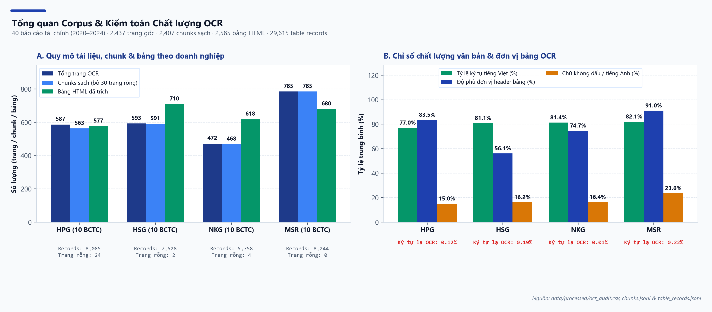

### 1.3. Xây dựng bộ Gold v4, chống rò rỉ dữ liệu và hậu kiểm chéo

#### 1.3.1. Lộ trình mở rộng từ v1 đến v4 và phân bố 204 câu hỏi

Do tập ViFinQA công khai không cung cấp đáp án chuẩn, trang trích dẫn hay phân chia tập kiểm thử, bộ dữ liệu chuẩn Gold được xây dựng có kiểm soát qua bốn phiên bản kế tiếp nhau:

a) Bản v1 (50 câu): kết hợp 35 câu `vifinqa` khớp corpus với 15 câu `supplement` tự biên soạn gồm 7 câu tra cứu hoặc tính biên lợi nhuận (`S_NEW_01..07`) và 8 câu từ chối ngoài corpus (`S_NEW_08..15`).

b) Bản v2 (127 câu) và v3 (200 câu): sinh bổ sung có kiểm soát 150 câu `table-clean` từ các bảng `consolidated` có độ tin cậy cao (`confidence >= 0.9`, có mã chỉ tiêu chuẩn và đã khử trùng theo cặp công ty, chỉ tiêu, năm và trang nguồn), gồm 55 câu T1 (tra cứu một giá trị), 44 câu T2 (so sánh biến động 2 năm), 43 câu T3 (tính chênh lệch giữa 2 năm) và 8 câu T5 (từ chối ngoài corpus).

c) Bản v4 (204 câu): ở bản v3, toàn bộ 35 câu `vifinqa` vẫn ở trạng thái chờ giải (`pending-answer`), đồng thời tập `dev` có 0 câu từ chối nên không đo được `refusal_precision` hay `refusal_recall` trên tập hiệu chỉnh. Bản v4 giải quyết và đối chiếu đầy đủ cả 35 câu `vifinqa` kèm phép tính và chuỗi trích dẫn nguyên văn trong tập chunk (đưa số câu chờ giải về 0), đồng thời bổ sung 4 câu từ chối ngoài corpus (`DEV-REF-01..04`) riêng vào tập `dev` (nâng từ 40 lên 44 câu) trong khi giữ nguyên tuyệt đối danh sách 160 câu `test` từ v3 (Bảng 4). Bốn câu bổ sung vào `dev` hỏi giá đóng cửa cổ phiếu HSG ngày 30/09/2024 (`DEV-REF-01`), kế hoạch doanh thu năm 2025 của NKG (`DEV-REF-02`), lợi nhuận sau thuế quý 2 năm 2024 của MSR (`DEV-REF-03`) và giá bán thép cuộn cán nóng USD/tấn của HPG năm 2024 (`DEV-REF-04`).

| Đặc trưng | Phân loại | Tổng (n = 204) | Dev (n = 44) | Test (n = 160) |
|---|---|---:|---:|---:|
| Nguồn (`source`) | `table-clean` (T1, T2, T3, T5) | 150 | 30 | 120 |
| Nguồn (`source`) | `vifinqa` | 35 | 9 | 26 |
| Nguồn (`source`) | `supplement` | 15 | 1 | 14 |
| Nguồn (`source`) | `dev-refusal` (`DEV-REF-01..04`) | 4 | 4 | 0 |
| Loại đáp án (`answer_type`) | `computation` | 94 | 21 | 73 |
| Loại đáp án (`answer_type`) | `numeric` | 90 | 19 | 71 |
| Loại đáp án (`answer_type`) | `unanswerable` | 20 | 4 | 16 |
| Trạng thái bằng chứng | Có đáp án và trích dẫn (`needs_more_evidence = false`) | 184 | 40 | 144 |
| Trạng thái bằng chứng | Thiếu bằng chứng (`needs_more_evidence = true`) | 20 | 4 | 16 |

*Bảng 4: Phân bố 204 câu hỏi bộ Gold v4 trên tập Dev và Test.*

Phân bố theo doanh nghiệp trên 204 câu gồm HSG (57 câu), NKG (52 câu), MSR (36 câu), HPG (34 câu) và 25 câu đa doanh nghiệp (22 câu hỏi cả 4 doanh nghiệp, 2 câu hỏi HPG, HSG, NKG và 1 câu hỏi HPG, MSR, HSG). Phân bố theo đơn vị đáp án chuẩn hóa gồm tỷ đồng (89), nghìn tỷ đồng (46), đơn vị rỗng cho câu đếm hoặc từ chối (21), triệu đồng (12), phần trăm (11), đồng (10), điểm phần trăm (9), lần (4), nghìn đồng (1) và trăm tỷ đồng (1). Theo `reviewer_id`, 204 câu được gắn nhãn bởi `auto-builder` (120), `auto-builder/reviewer-2` (30), `annotator-1` (23), `annotator-1/reviewer-2` (16), `member-1/reviewer-2` (6), `member-1/member-2` (5) và `member-1` (4). Bảng quy đổi đơn vị chuẩn, phân loại chi tiết năm tầng T1-T5 và tám mẫu trích nguyên văn đại diện cho đủ cả bốn nguồn được trình bày tại Phụ lục A (Bảng 15 và Bảng 16).

#### 1.3.2. Quy tắc gắn nhãn, khóa split và hậu kiểm chéo phân tầng

Quy tắc gắn nhãn chuẩn hóa v0.2 quy định bốn nguyên tắc nhất quán:

1. Chọn phiên bản báo cáo: câu hỏi có từ khóa "công ty mẹ" hoặc "riêng" trích xuất trên bản `separate`, các câu hỏi còn lại dùng bản `consolidated`.

2. Chọn cột kỳ và thuyết minh: chỉ lấy đúng cột của năm được hỏi (hoặc cột "Số đầu năm" hay "1/1/2020" trên báo cáo năm 2020 khi truy vấn số liệu năm 2019), tránh lấy nhầm sang cột so sánh ở năm sau hoặc thuyết minh trừ khi câu hỏi chỉ định trực tiếp chỉ tiêu thuyết minh.

3. Quy đổi đơn vị và làm tròn: quy đổi giá trị từ đồng hoặc nghìn đồng về đúng đơn vị đích trong câu hỏi và làm tròn tối đa 4 chữ số thập phân qua `round(x, 4)`.

4. Xử lý câu thiếu bằng chứng: các câu vượt phạm vi corpus nhận `needs_more_evidence = true`, `answer_type = "unanswerable"`, danh sách bằng chứng rỗng, đáp án chuẩn nguyên văn "Không đủ bằng chứng trong corpus để trả lời." và ghi rõ các cụm từ khóa đã dò với 0 kết quả trên toàn bộ 2.407 chunk.

Khi phát sinh bất đồng giữa các thành viên gắn nhãn, quy trình kiểm định xử lý theo ba quy tắc: hậu kiểm chéo tối thiểu 20% toàn bộ câu hỏi bởi người kiểm chứng độc lập thứ hai; với bất đồng về số liệu hoặc đơn vị, hai bên đối chiếu trực tiếp chunk nguồn gốc và sửa theo đúng văn bản nguyên trạng; với bất đồng về quy tắc hoặc biên giới kế toán (như số gốc năm hỏi so với số phân loại lại năm sau, hoặc báo cáo hợp nhất so với riêng), nhật ký hậu kiểm ghi nhận chi tiết ca bất đồng, chốt quyết định theo quy ước ưu tiên báo cáo chính thức của đúng năm được hỏi và cập nhật quy tắc chung cho toàn bộ dữ liệu thay vì sửa lẻ từng mẫu.

Nhằm phòng chống rò rỉ dữ liệu, hệ thống áp dụng bốn rào chắn: tách tập `dev` (44 câu) và `test` (160 câu) ở cấp câu hỏi sau khi kiểm tra trùng lặp chữ thường và khoảng trắng (`norm_question()`) bảo đảm 0 câu trùng hoặc diễn đạt lặp giữa hai tập, đồng thời giữ mỗi chunk đúng một trang duy nhất; công bố minh bạch việc cả hai tập cùng truy vấn trên kho cố định 40 báo cáo theo thông lệ đánh giá RAG trên BCTC cố định và không suy diễn khả năng tổng quát sang doanh nghiệp ngoài phạm vi khi chưa có phép chia giữ riêng công ty; khóa cứng toàn bộ 160 mã câu hỏi và đáp án `test` từ v3 bằng `seed = 42` và mã băm `SHA-256` `0012ebccd6712b44cdd1faf18f020c547c82973db09d37ab2b9e96b0a94a34b4`, chỉ hiệu chỉnh luật và tham số trên `dev`; đồng thời gắn cờ bảo vệ bộ khởi tạo v1 để từ chối ghi đè nếu tập gold hiện hữu đã vượt quá 50 bản ghi.

Công tác hậu kiểm chéo chạy tự động với `seed = 42` trên hai tầng độc lập (chi tiết tại Phụ lục A, Bảng 17):

a) Kiểm tra toàn vẹn trích dẫn 204/204 câu: 35/35 câu `vifinqa` và 7/7 câu `supplement` trả lời được có chuỗi trích dẫn trong `evidence` là chuỗi con khớp nguyên văn trong văn bản chunk tại đúng `source_page == page`; 142/142 câu `table-clean` trả lời được có cặp tên chỉ tiêu và giá trị thô đồng thời xuất hiện trên một dòng phân tách của chunk nguồn.

b) Kiểm toán phân tầng độc lập trên 53 / 204 câu (25.98%), gồm 30 câu `table-clean` (10 T1, 9 T2, 9 T3, 2 T5), 12 câu `vifinqa`, 7 câu `supplement` và 4 câu `dev-refusal` (14 câu `dev`, 39 câu `test`; 25 `numeric`, 19 `computation`, 9 `unanswerable`). Trình kiểm toán đọc trực tiếp con số thô và đơn vị trang từ chunk (không đọc trường công thức sẵn có), tính lại đến 4 chữ số thập phân cho 44/44 câu trả lời được và chạy dò toàn văn trên 2.407 chunk cho 9/9 câu từ chối (0 kết quả). Kết quả ghi nhận 0 bất đồng, nâng tỷ lệ `reviewed-agree` tích lũy lên **57 / 204 (27.94%)**, vượt ngưỡng tối thiểu 20%.

Ngoài các con số thống kê, quá trình hậu kiểm ghi nhận ba ca ranh giới kế toán và hai ca ranh giới cổ tức đáng lưu ý. Với `ViFinQA-97` (99.988 %, `test`), bảng thuyết minh 12.2 BCTC riêng `HPG_2023_separate#p027` ghi tỷ lệ sở hữu trực tiếp tại Công ty CP Gang thép Hòa Phát là 99,988% (khớp cột số đầu năm 2024), khác với tỷ lệ lợi ích hiệu quả hợp nhất toàn tập đoàn 99,999% tại `HPG_2023_consolidated#p017`. Với `ViFinQA-186` (10850162726 nghìn đồng, `test`), Thuyết minh 21(b) trên `MSR_2023_consolidated#p060` nêu tổng vay và trái phiếu dài hạn gốc là 10.850.162.726 nghìn đồng, trong khi chỉ tiêu mã 338 trên CĐKT (8.760.544.403 nghìn đồng) đã trừ phần nợ dài hạn đến hạn trả trong 12 tháng (2.089.618.323 nghìn đồng). Với `ViFinQA-709` (9.1149 %, `test`), phép chia dùng số liệu chính thức trên BCTC năm `MSR_2022_consolidated` (chi phí lãi vay mã 23 = 1.194.553.796 chia nợ vay ngắn hạn mã 320 = 13.105.475.407 nghìn đồng), không dùng cột so sánh năm 2022 bị phân loại lại trên BCTC 2023 (1.119.988.084 nghìn đồng). Đối với hai câu từ chối `CLEAN-T5-HPG-2024-01` và `CLEAN-T5-HSG-2025-06`, BCTC năm trong corpus chỉ phản ánh dòng tiền chi trả cổ tức thực hiện cho niên độ trước chứ không công bố mức cổ tức trên mỗi cổ phiếu cho năm 2024, nên được gắn nhãn thiếu bằng chứng (Hình 2).

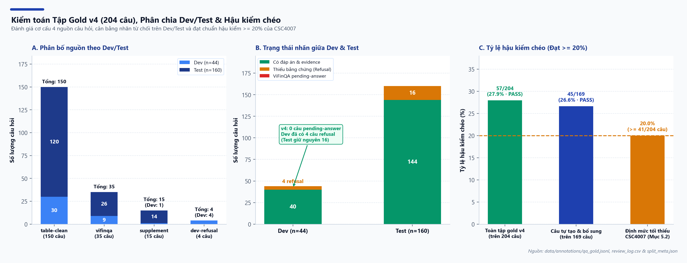

## CHƯƠNG 2. THIẾT KẾ HỆ THỐNG, CẤU HÌNH THỰC NGHIỆM VÀ GIAO THỨC ĐÁNH GIÁ

### 2.1. Kiến trúc tổng thể hệ thống RAG offline trên CPU

Toàn bộ hệ thống vận hành ngoại tuyến trên CPU với Python 3.10.22 và bộ thư viện cố định phiên bản (`scikit-learn 1.7.2`, `pandas 2.3.3`, `numpy 2.2.6`, `scipy 1.15.3`, `PyYAML 6.0.3`, `streamlit 1.65.0`), không gọi API mô hình ngôn ngữ bên ngoài và không sử dụng thư viện học sâu nặng. Kiến trúc gồm năm tầng nối tiếp (Hình 3):

a) Tầng chuẩn hóa và lập chỉ mục: chuyển đổi 40 báo cáo OCR thành 2.407 chunk cấp trang và 29.615 bản ghi bảng có cấu trúc, đi kèm mô đun tách từ tiếng Việt giữ dấu `Unicode NFC` (`normalize_query()`, `tokenize_vi()` loại 21 từ dừng cơ bản).

b) Tầng phân tích truy vấn và cổng từ chối: trích xuất doanh nghiệp, năm tài chính, phiên bản báo cáo, đơn vị mục tiêu và đánh giá điều kiện ngoài corpus qua mô đun tra cứu dùng chung (`table_lookup`).

c) Tầng truy hồi và xếp hạng ứng viên (E0 đến E7): thực hiện tìm kiếm từ khóa BM25 (E0), tìm kiếm ngữ nghĩa tiềm ẩn LSA qua `TruncatedSVD` (E1), hợp nhất đa tín hiệu kèm thưởng siêu dữ liệu (E2), lọc cứng siêu dữ liệu (E3), hợp nhất RRF và xếp hạng lại (E4), mở rộng biến thể truy vấn (E5), lập chỉ mục bảng riêng (E6) và gắn tiền tố ngữ cảnh đầu trang (E7).

d) Tầng tra cứu có cấu trúc và tổng hợp đáp án (E8 và ứng dụng tương tác): kết hợp tìm kiếm trên 29.615 bản ghi bảng qua `synthesize_answer()` với danh sách chứng cứ truy hồi lai, thực hiện quy đổi đơn vị, tính chênh lệch hai năm hoặc tính biên lợi nhuận và gắn nhãn trạng thái qua mô đun chính sách trả lời (`answer_policy`).

e) Tầng đánh giá và giao diện tương tác: bộ chấm điểm tách bốn tầng chấm đồng bộ cả 9 cấu hình trên cùng phân chia v4 (`dev = 44`, `test = 160`), liên kết trực tiếp với giao diện web Streamlit và bộ kiểm thử tự động.

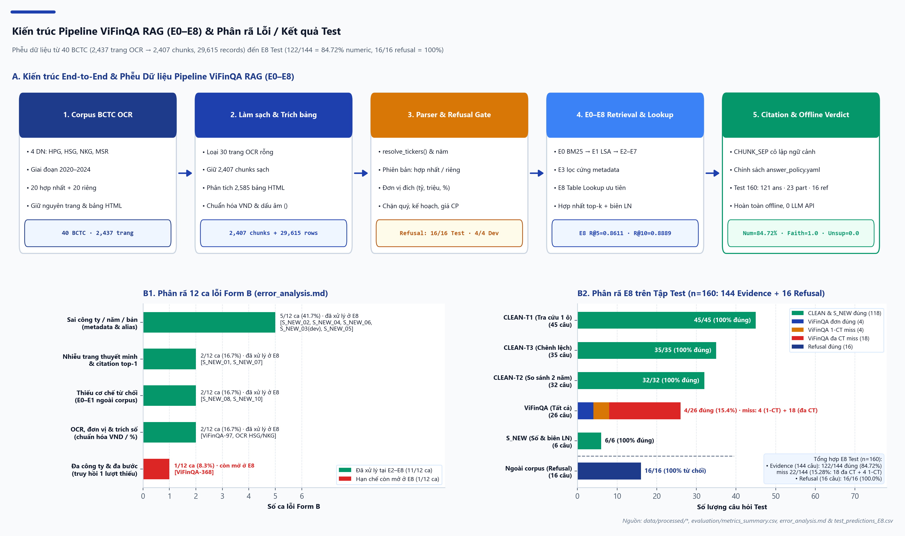

### 2.2. Phân tích thực thể câu hỏi, cổng từ chối và chính sách trạng thái

Mọi bước phân tích câu hỏi và kiểm soát đầu ra dùng chung cùng một logic giữa cấu hình thực nghiệm E8 và ứng dụng minh họa. Ở tầng phân tích câu hỏi (`detect_query_meta()`), hàm `resolve_tickers()` nhận diện đồng thời mã cổ phiếu viết hoa (HPG, HSG, NKG, MSR) với ranh giới từ chặt để tránh bắt nhầm chuỗi con (như `XHPGR`) và ánh xạ tên doanh nghiệp tiếng Việt đầy đủ ("Hòa Phát", "Hoa Sen", "Nam Kim", "Masan High-Tech Materials"). Hàm `detect_report_version()` phân biệt bản `consolidated` và `separate`, đồng thời loại trừ các cụm cố định thường gặp trên bảng hợp nhất (như "cổ đông của công ty mẹ", "lợi nhuận sau thuế của công ty mẹ") để không gắn nhầm sang bản riêng. Hàm `parse_target_unit()` xác định chính xác đơn vị tiền tệ hoặc tỷ lệ cần trả về, loại trừ các từ dễ gây nhiễu như "tỷ lệ", "Hội đồng", "triệu cổ phiếu".

Cổng từ chối (`check_refusal()`) kết hợp khớp từ khóa mẫu và luật ngữ nghĩa theo phạm vi corpus. Mười lăm mẫu từ khóa trong cấu hình E8 gồm: "quý", "bán niên", "6 tháng", "kế hoạch", "dự báo", "dự kiến", "giá đóng cửa", "vốn hóa thị trường", "thị giá", "xếp hạng tín nhiệm", "cổ tức trên cổ phiếu", "giá cổ phiếu", "giá bán bình quân", "tổng số cổ đông" và "số lượng cổ đông". Ở tầng ngữ nghĩa, mẫu "quý" kiểm tra ranh giới từ tiếng Việt để bảo vệ từ "quỹ" (ví dụ "Quỹ đầu tư phát triển") khỏi bị chặn nhầm; các mẫu kỳ dưới 1 năm chặn thêm "6 tháng đầu năm", "6 tháng cuối năm", "9 tháng đầu năm", "nửa đầu năm" và `q1` đến `q4`; các ràng buộc năm chặn mọi câu hỏi năm trước 2020 hoặc từ 2025 trở đi cùng các cụm tương lai ("mục tiêu năm", "ước tính cả năm"); quy tắc cổ tức chặn "cổ tức" đi kèm "cổ phiếu", "/cp", "tỷ lệ cổ tức", "mức cổ tức" nhưng vẫn cho phép các dòng tiền hợp lệ ("Tiền trả cổ tức") và chỉ tiêu EPS ("lãi cơ bản trên cổ phiếu", "lãi suy giảm trên cổ phiếu"); đồng thời chặn các truy vấn ngoại tệ (`USD`, `EUR`, "USD/tấn"). Trên giao diện tương tác đối với các câu hỏi tự do không chạm 15 mẫu từ khóa, hàm `_should_refuse_unmatched()` kiểm tra thêm tỷ lệ phủ từ vựng nội dung để từ chối an toàn các câu hỏi ngoài chủ đề tài chính (như thời tiết hoặc doanh nghiệp ngoài 4 mã).

Chính sách sinh câu trả lời trong bộ quy chuẩn áp dụng năm nguyên tắc bắt buộc cho tầng tổng hợp:
1. Chỉ sử dụng thông tin từ các chunk được cấp.
2. Trích dẫn đầy đủ `chunk_id`, `page`, `company`, `year` cho mỗi con số nêu ra.
3. Không suy diễn ngoài ngữ cảnh `CONTEXT`.
4. Nếu thiếu dữ liệu, trả lời đúng nguyên văn: "Không đủ bằng chứng trong corpus để trả lời."
5. Nếu tồn tại nhiều giá trị mâu thuẫn, đánh dấu trạng thái `ambiguous` và nêu rõ điểm cần làm rõ.

Dựa trên danh sách `top_chunks[:5]`, hàm `decide_status()` phân loại đầu ra về đúng một trong bốn nhãn trạng thái theo thứ tự ưu tiên từ cao xuống thấp tại Bảng 5.

| Thứ tự | Trạng thái | Điều kiện kích hoạt | Mã lý do |
|---:|---|---|---|
| 1 | `refused` | Cổng từ chối kích hoạt hoặc đáp án khớp mẫu từ chối chuẩn | `rule_or_empty_evidence` |
| 2 | `ambiguous` | Có >= 2 giá trị khác nhau cho cùng bộ `(company, year, metric)` hoặc câu đơn thực thể có top-1 lệch doanh nghiệp/năm trong khi top-5 chứa cả thực thể đích | `conflicting_values` |
| 3 | `refused` | Danh sách chunk truy hồi rỗng | `no_chunks` |
| 4 | `partial_answer` | Đáp án dự đoán rỗng hoặc chỉ gồm khoảng trắng | `missing_answer` |
| 5a | `partial_answer` | Câu hỏi đa công ty nhưng `top_chunks[:5]` chưa phủ đủ tất cả mã công ty hỏi | `missing_multi_entity_evidence` |
| 5b | `partial_answer` | Mã công ty của chunk top-1 không thuộc tập công ty hỏi | `company_mismatch` |
| 6a | `partial_answer` | Câu hỏi đa năm nhưng `top_chunks[:5]` chưa phủ đủ tất cả năm hỏi | `missing_multi_entity_evidence` |
| 6b | `partial_answer` | Năm tài chính của chunk top-1 không thuộc tập năm hỏi | `year_mismatch` |
| 7 | `partial_answer` | Chunk top-1 thiếu số trang nguồn hợp lệ | `missing_page` |
| 8 | `answered` | Thỏa mãn đầy đủ mọi điều kiện trên | `evidence_sufficient` |

*Bảng 5: Thứ tự ưu tiên và điều kiện kích hoạt bốn trạng thái đầu ra.*

### 2.3. Thiết kế 9 cấu hình thực nghiệm từ E0 đến E8

#### 2.3.1. Ba cấu hình nền tảng E0, E1 và E2

Ba cấu hình đầu tiên đối chứng trực tiếp hai mô hình biểu diễn đơn lẻ với mô hình lai kèm cổng từ chối:

a) E0 (Baseline từ khóa): dùng BM25 unigram (`k1 = 1.5`, `b = 0.75`) trên 2.407 chunk [5], chỉ trả về danh sách tối đa 10 chunk kèm siêu dữ liệu trích dẫn, không sinh đáp án số và không bật cổng từ chối.

b) E1 (Biểu diễn dày đặc LSA): dùng TF-IDF n-gram `(1, 2)` với `sublinear_tf = True`, `min_df = 2` (tạo từ vựng 57.314 mục), sau đó nén bằng phân rã giá trị suy biến `TruncatedSVD` xuống 128 chiều (`seed = 42`) và chuẩn hóa vector L2 để xếp hạng theo độ tương đồng cosine [6]. Cấu hình kiểm chứng xem không gian ngữ nghĩa ẩn có khắc phục được khác biệt cách diễn đạt giữa câu hỏi và báo cáo hay không.

c) E2 (Mô hình lai và cổng từ chối): chuẩn hóa min-max điểm BM25 và LSA trên top-20 ứng viên mỗi nhánh rồi kết hợp tuyến tính `0.5 BM25 + 0.5 LSA`, cộng điểm thưởng siêu dữ liệu (`+0.15` nếu khớp đủ công ty và năm, `+0.075` nếu khớp một phần) và bật cổng từ chối `check_refusal()`. Cấu hình kiểm chứng mức cải thiện khi hợp nhất từ khóa với ngữ nghĩa và khả năng loại bỏ trả lời bừa ngoài phạm vi.

#### 2.3.2. Các cấu hình mở rộng E3 đến E7 và cấu hình đề xuất E8

Năm cấu hình ablation E3 đến E7 thử nghiệm từng kỹ thuật cải thiện thuần truy hồi trên nền tảng E2, còn E8 tích hợp tra cứu bảng có cấu trúc với truy hồi lai (Bảng 6). Cả chín cấu hình đều lưu đủ danh sách tối đa 10 `predicted_chunk_ids` trên hai tập `dev` và `test` để chấm công bằng tại các ngưỡng `@3`, `@5` và `@10`.

| Run | Vai trò | Cơ chế kỹ thuật và siêu tham số chính | Giả thuyết kiểm chứng |
|---|---|---|---|
| E0 | Baseline nền tảng | BM25 unigram (`k1 = 1.5`, `b = 0.75`), giữ dấu NFC, không sinh số, không từ chối | Đo sức mạnh khớp từ khóa thuần túy trên văn bản BCTC OCR |
| E1 | Đối chứng 1 (Dense) | TF-IDF `(1, 2)` (`min_df = 2`, 57.314 từ) + `TruncatedSVD` 128 chiều (`seed = 42`), cosine | Kiểm tra biểu diễn ẩn dày đặc có bắt cụm từ đồng nghĩa tốt hơn BM25 |
| E2 | Đối chứng 2 (Hybrid) | Fusion `0.5 BM25 + 0.5 LSA` chuẩn hóa min-max top-20 + thưởng meta `0.15` + `check_refusal()` | Kiểm tra hiệu quả kết hợp hai tín hiệu kèm thưởng meta và cổng từ chối |
| E3 | Ablation nâng cao | Lọc cứng tập chunk theo mã công ty, năm, phiên bản (dự phòng khi `< 5` chunk) trước khi fusion `0.5 BM25 + 0.5 LSA` | Xóa nhiễu kéo nhầm sang doanh nghiệp và niên độ khác |
| E4 | Ablation nâng cao | Hợp nhất `RRF(k = 60)` top-20 BM25 + LSA, rồi rerank nhẹ (`0.5 fused + 0.3 cover + 0.1 metric + 0.1 meta + 0.05` bảng) [7] | Ưu tiên trang bảng khớp cao tên chỉ tiêu lên vị trí top-1 |
| E5 | Ablation nâng cao | Tách thực thể và từ khóa chỉ tiêu tạo tối đa 3 biến thể câu hỏi (`query_variants()`), lấy max-pooling BM25 và LSA | Giảm lệch từ khóa do câu hỏi dài hoặc đặt tên đầy đủ doanh nghiệp |
| E6 | Ablation nâng cao | Đánh chỉ mục BM25 riêng cho khối văn bản bảng, phối `0.7 full_bm25 + 0.3 table_bm25` trước khi fusion LSA | Tăng trọng số cho trang chứa bảng số liệu thay vì thuyết minh |
| E7 | Ablation nâng cao | Gắn tiền tố ngữ cảnh `[CTY \| Nam \| Ban \| Trang \| Don vi \| Bang]` vào đầu mỗi chunk khi lập chỉ mục | Giúp BM25 và LSA bám chặt siêu dữ liệu báo cáo ở đầu trang |
| E8 | Đề xuất hoàn chỉnh | Tra cứu bảng có cấu trúc trên 29.615 bản ghi (`synthesize_answer()`, `lookup_min_score = 0.4`), đưa chunk nguồn lên top-1 và lấp top-10 bằng hybrid RAG | Đạt đồng thời độ chính xác số học cao, trích dẫn đúng trang và 0 sai lệch ngữ cảnh |

*Bảng 6: Tổng hợp thiết kế kỹ thuật chín cấu hình thực nghiệm từ E0 đến E8.*

Quy trình tổng hợp đáp án `synthesize_answer()` ở E8 xử lý tuần tự theo năm bước xác định:

a) Chạy `check_refusal()` trước để từ chối nguyên văn các truy vấn ngoài phạm vi BCTC năm.

b) Nếu câu hỏi đề cập nhiều hơn một doanh nghiệp hoặc thuộc dạng định tính không hỏi số liệu, chủ động dừng sinh đáp án (nhận `partial_answer`) để không suy đoán con số từ một công ty đơn lẻ.

c) Với câu hỏi so sánh hoặc tính chênh lệch giữa hai năm (nhóm T2 và T3, nhận diện qua `is_comparison_query()`), gọi `lookup_comparison_pair()` ghép cặp bản ghi cùng doanh nghiệp, cùng phiên bản báo cáo và cùng mã chỉ tiêu (`metric_code`) hoặc cùng tên chỉ tiêu chuẩn hóa cho năm cũ và năm mới, quy đổi về đơn vị đích rồi tính hiệu năm mới trừ năm cũ (xuất câu kết luận tăng/giảm cho T2 hoặc giá trị chênh lệch kèm công thức cho T3).

d) Với câu hỏi biên lợi nhuận gộp, gọi `_compute_margin_single()` tra riêng mã dòng 20 (Lợi nhuận gộp) và mã dòng 10 (Doanh thu thuần), quy đổi cả hai về đơn vị gốc đồng trước khi chia và nhân 100%.

e) Với câu tra cứu một chỉ tiêu, gọi `lookup_records()` áp dụng hàm chấm `metric_score()` có bộ bảo vệ ngữ nghĩa phân biệt "ngắn hạn" với "dài hạn", "trước thuế" với "sau thuế", "phải thu" với "phải trả", "lãi cơ bản" với "lãi suy giảm", kiểm tra tương thích đơn vị qua `is_unit_compatible()` (chẳng hạn chỉ nhận đơn vị `%` khi hỏi tỷ lệ sở hữu) và quy đổi sang đơn vị đích trước khi đưa chunk chứng cứ lên top-1.

### 2.4. Giao thức đánh giá v9 và thiết kế ứng dụng demo

Giao thức đánh giá v9 đo lường đồng thời bốn tầng chỉ số độc lập trên bộ phân chia đóng băng v4 (Bảng 7). Tập mẫu kiểm thử gồm `n = 160` câu `test` (trong đó tập có bằng chứng `E` có `evidence_den = 144`, tập cần từ chối `U` có `refusal_den = 16`, tập đáp án số `A` có `ans_num_den = 144`, tập đầy đủ kỳ có `period_den = 56`, và tập có đáp án số sinh ra trên E8 có `unsup_den = 122`) và `n = 44` câu `dev` (`evidence_den = 40`, `refusal_den = 4`, `ans_num_den = 40`, `period_den = 13`, `unsup_den = 33` trên E8).

| Tầng | Thước đo | Mẫu số | Định nghĩa và công thức tính |
|---|---|---|---|
| 1. Truy hồi | `Recall@k` (k = 3, 5, 10) | `\|E\|` | Tỷ lệ câu có ít nhất 1 chunk thuộc tập bằng chứng gold `G_q` trong `top_k(q)` |
| 1. Truy hồi | `MRR@k` (k = 3, 5, 10) | `\|E\|` | Trung bình `1 / rank_1(q)` của chunk đúng đầu tiên trong `top_k(q)`, bằng `0` nếu vắng |
| 1. Truy hồi | `ctxP@5` / `ctxR@5` | `\|E\|` | `ctxP@5` = trung bình `(\|top_5(q) ∩ G_q\| / 5)`; `ctxR@5` = trung bình `(\|top_5(q) ∩ G_q\| / \|G_q\|)` |
| 2. Trích dẫn | `citeP@top1` / `citeR@5` | `\|E\|` | `citeP@top1` là tỷ lệ top-1 thuộc `G_q`; `citeR@5` bằng `Recall@5` trên `E` |
| 2. Trích dẫn | `citeFull` / `page_acc` | `n` / `\|E\|` | `citeFull` kiểm tra top-1 đủ 4 trường `{chunk_id, page, company_id, fiscal_year}`; `page_acc` so khớp `predicted_page == source_page` |
| 3. Đáp án & Trung thực | `numeric_match` / `exact_match` | `\|A\|` | Chuẩn hóa số âm ngoặc, dấu phẩy/chấm; khớp `c` khi `\|c - gv\| <= max(1e-4, \|gv\| × 1e-6)`; `exact_match` so khớp nguyên văn sau chuẩn hóa |
| 3. Đáp án & Trung thực | `company / year / version / period` | `n` / `period_den` | So khớp tập thực thể phân tách bởi dấu gạch đứng (`parse_pipe_set()`); `period` đòi hỏi đúng đồng thời cả công ty, năm và phiên bản |
| 3. Đáp án & Trung thực | `unsup` / `faith_h` / `relev_h` | `unsup_den` / `n` | `unsup` là tỷ lệ câu có số không chứng minh được trong từng chunk `top-5`; `faith_h = 1 - unsup` (nếu `unsup_den > 0`); `relev_h = (numeric_hit + true_refusal) / n` |
| 4. Từ chối & Trạng thái | `refP` / `refR` / `falseAns` | Tổng từ chối / `\|U\|` / `n` | `refP = true_refusal /` tổng câu từ chối; `refR = true_refusal / \|U\|`; `falseAns = 1 - relev_h`; thống kê 4 nhãn từ chối và 4 trạng thái |

*Bảng 7: Giao thức đánh giá bốn tầng v9 áp dụng đồng nhất cho E0 đến E8.*

Để phát hiện lỗi bịa số hoặc ghép số xuyên trang khi tính `unsupported_claim_rate` (`unsup`), hàm `numbers_in_context()` thực hiện ba bước kiểm tra chặt trên ngữ cảnh `top-5`: tách độc lập từng chunk qua ranh giới `CHUNK_SEP` để cấm ghép phép tính giữa hai trang khác nhau; loại bỏ các số năm tiêu đề cột bảng (2020 đến 2025) và chỉ chấp nhận quy đổi đơn vị trong dải hệ số `1e3` đến `1e12` với sai số tương đối `1e-3`; chỉ cho phép các phép toán suy diễn nội tại trong cùng một chunk gồm hiệu `a - b` (trên cùng dòng hoặc chunk gọn tối đa 8 số), tổng `a + b`, tỷ lệ biên `a / b × 100` (cùng dòng, chunk gọn hoặc cột lân cận trong phạm vi 3 dòng) và tỷ số `a / b`. Nếu bất kỳ con số khẳng định nào trong đáp án không được chứng minh trong một chunk đơn lẻ thuộc `top-5`, câu trả lời bị gắn cờ không trung thực.

Ứng dụng minh họa tương tác bằng Streamlit sử dụng chung 100% mô đun tra cứu bảng `table_lookup` và chính sách trạng thái `answer_policy` với cấu hình E8. Giao diện tuyệt đối không đọc hay tra cứu đáp án chuẩn gold để trả lời; bộ câu hỏi gold chỉ phục vụ hàm `suggest_closest()` gợi ý tối đa 3 câu hỏi gần nhất khi truy vấn tự do của người dùng không tìm thấy ô bảng phù hợp. Phần trình bày theo chủ đề **Financial Intelligence** (Cobalt Navy `#1E40AF`, Slate `#F8FAFC`, Amber `#D97706`), gắn quy tắc `color-scheme: light` ngăn xung đột chế độ tối trên trình duyệt, tích hợp thanh bên với 13 câu hỏi mẫu, thanh trượt chọn `top-k`, thẻ kết luận `Verdict Card` hiển thị trạng thái và công thức nguồn, lưới 4 thẻ thông số thực thể ("Doanh nghiệp", "Năm tài chính", "Phiên bản BCTC", "Đơn vị & Chỉ tiêu"), tab "Chứng cứ Top-K & Bảng số liệu gốc" có thang điểm chuẩn hóa đơn điệu trong `[0.0, 1.0]` và tab "CONTEXT gửi bộ sinh & Nhật ký truy hồi".

## CHƯƠNG 3. KẾT QUẢ THỰC NGHIỆM, PHÂN TÍCH LỖI VÀ KIỂM CHỨNG SẢN PHẨM

### 3.1. Kết quả thực nghiệm định lượng trên tập Dev và Test

#### 3.1.1. Kết quả trên tập Dev (n = 44) và cơ sở lựa chọn cấu hình

Bảng 8 tổng hợp kết quả định lượng của cả chín cấu hình trên tập hiệu chỉnh `dev` (`n = 44`, gồm 40 câu có bằng chứng và 4 câu từ chối `DEV-REF-01..04`).

| Run | R@3 | R@5 | R@10 | MRR@5 | MRR@10 | citeP@top1 | period | numeric | exact | faith_h | falseAns | refP | refR | ans / part / ref / amb |
|---|---:|---:|---:|---:|---:|---:|---:|---:|---:|---:|---:|---:|---:|---|
| E0 | 0.0500 | 0.1000 | 0.1750 | 0.0600 | 0.0681 | 0.0500 | 0.3077 | 0.0000 | 0.0000 | 0.0000 | 1.0000 | 0.0000 | 0.0000 | 0 / 35 / 0 / 9 |
| E1 | 0.1000 | 0.1250 | 0.1500 | 0.0758 | 0.0783 | 0.0500 | 0.1538 | 0.0000 | 0.0000 | 0.0000 | 1.0000 | 0.0000 | 0.0000 | 0 / 33 / 0 / 11 |
| E2 | 0.0750 | 0.1250 | 0.2750 | 0.0708 | 0.0895 | 0.0500 | 0.3846 | 0.0000 | 0.0000 | 0.0000 | 0.9091 | 1.0000 | 1.0000 | 0 / 33 / 4 / 7 |
| E3 | 0.1750 | 0.3000 | 0.4000 | 0.1258 | 0.1395 | 0.0500 | 0.4615 | 0.0000 | 0.0000 | 0.0000 | 0.9091 | 1.0000 | 1.0000 | 0 / 34 / 4 / 6 |
| E4 | 0.2000 | 0.2750 | 0.3000 | 0.1746 | 0.1788 | 0.1250 | 0.6923 | 0.0000 | 0.0000 | 0.0000 | 0.9091 | 1.0000 | 1.0000 | 0 / 36 / 4 / 4 |
| E5 | 0.1000 | 0.1250 | 0.2500 | 0.0758 | 0.0934 | 0.0500 | 0.4615 | 0.0000 | 0.0000 | 0.0000 | 0.9091 | 1.0000 | 1.0000 | 0 / 34 / 4 / 6 |
| E6 | 0.1000 | 0.1500 | 0.3250 | 0.0779 | 0.1009 | 0.0500 | 0.3846 | 0.0000 | 0.0000 | 0.0000 | 0.9091 | 1.0000 | 1.0000 | 0 / 33 / 4 / 7 |
| E7 | 0.0750 | 0.1000 | 0.2500 | 0.0646 | 0.0843 | 0.0500 | 0.4615 | 0.0000 | 0.0000 | 0.0000 | 0.9091 | 1.0000 | 1.0000 | 0 / 36 / 4 / 4 |
| **E8** | **0.8500** | **0.8500** | **0.9250** | **0.8500** | **0.8602** | **0.8500** | **1.0000** | **0.8250** | **0.8000** | **1.0000** | **0.1591** | **1.0000** | **1.0000** | **32 / 8 / 4 / 0** |

*Bảng 8: Kết quả thực nghiệm trên tập Dev (n = 44, evidence_den = 40, refusal_den = 4).*

Trên tập `dev`, phương pháp lai E2 nâng `Recall@10` từ 0.1750 (E0) và 0.1500 (E1) lên 0.2750, đồng thời kích hoạt cổng từ chối đạt 4/4 (`refP = 1.0`, `refR = 1.0`). Trong nhóm ablation thuần truy hồi, lọc cứng siêu dữ liệu E3 dẫn đầu về độ phủ với `Recall@5 = 0.3000` và `Recall@10 = 0.4000`, trong khi xếp hạng lại nhẹ E4 đạt độ chính xác top-1 cao nhất nhóm thuần truy hồi (`MRR@5 = 0.1746`, `citeP@top1 = 0.1250`, `period = 0.6923`). Cấu hình E8 đạt `Recall@5 = 0.8500`, `Recall@10 = 0.9250`, `numeric_match = 0.8250` (33/40 câu) và `faith_h = 1.0000`. Dựa trên tập hiệu chỉnh `dev`, hệ thống chọn E8 làm cấu hình đề xuất hoàn chỉnh cho bài toán hỏi đáp số liệu có trích dẫn và giữ E3 làm mốc chuẩn lọc cứng cho nhánh thuần truy hồi trước khi chấm độc lập trên tập `test`.

#### 3.1.2. Kết quả trên tập Test độc lập (n = 160)

Sau khi khóa tham số từ `dev`, cả chín cấu hình được đánh giá đồng thời trên 160 câu `test` (144 câu có bằng chứng, 16 câu cần từ chối) ở Bảng 9 (truy hồi và trích dẫn) và Bảng 10 (đáp án số, kỳ báo cáo, độ trung thực và từ chối).

| Run | R@3 | R@5 | R@10 | MRR@3 | MRR@5 | MRR@10 | ctxP@5 | ctxR@5 | citeP@top1 | citeR@5 | page_acc | citeFull |
|---|---:|---:|---:|---:|---:|---:|---:|---:|---:|---:|---:|---:|
| E0 | 0.0486 | 0.0764 | 0.1250 | 0.0440 | 0.0502 | 0.0563 | 0.0153 | 0.0764 | 0.0417 | 0.0764 | 0.0486 | 1.0000 |
| E1 | 0.0278 | 0.0417 | 0.0903 | 0.0185 | 0.0220 | 0.0284 | 0.0083 | 0.0296 | 0.0139 | 0.0417 | 0.0278 | 1.0000 |
| E2 | 0.1042 | 0.1389 | 0.2083 | 0.0567 | 0.0650 | 0.0743 | 0.0278 | 0.1267 | 0.0208 | 0.1389 | 0.0278 | 1.0000 |
| E3 | 0.1319 | 0.2361 | 0.4167 | 0.0903 | 0.1142 | 0.1377 | 0.0514 | 0.2016 | 0.0556 | 0.2361 | 0.0764 | 1.0000 |
| E4 | 0.1389 | 0.1944 | 0.2986 | 0.0961 | 0.1082 | 0.1226 | 0.0403 | 0.1772 | 0.0625 | 0.1944 | 0.0694 | 1.0000 |
| E5 | 0.1042 | 0.1458 | 0.2222 | 0.0556 | 0.0642 | 0.0734 | 0.0306 | 0.1350 | 0.0208 | 0.1458 | 0.0347 | 1.0000 |
| E6 | 0.1042 | 0.1875 | 0.2500 | 0.0590 | 0.0785 | 0.0861 | 0.0417 | 0.1388 | 0.0278 | 0.1875 | 0.0417 | 1.0000 |
| E7 | 0.1042 | 0.1458 | 0.2153 | 0.0637 | 0.0734 | 0.0827 | 0.0292 | 0.1208 | 0.0347 | 0.1458 | 0.0347 | 1.0000 |
| **E8** | **0.8472** | **0.8611** | **0.8889** | **0.8472** | **0.8507** | **0.8547** | **0.1722** | **0.8490** | **0.8472** | **0.8611** | **0.8472** | **1.0000** |

*Bảng 9: Kết quả truy hồi và trích dẫn trên tập Test (n = 160, evidence_den = 144).*

| Run | numeric | exact | period | company | year | version | unsup | faith_h | relev_h | falseAns | refP | refR | TR / MR / FR / TA | ans / part / ref / amb |
|---|---:|---:|---:|---:|---:|---:|---:|---:|---:|---:|---:|---:|---|---|
| E0 | 0.0000 | 0.0000 | 0.3036 | 0.4437 | 0.3187 | 0.7679 | 0.0000 | 0.0000 | 0.0000 | 1.0000 | 0.0000 | 0.0000 | 0 / 16 / 0 / 144 | 0 / 125 / 0 / 35 |
| E1 | 0.0000 | 0.0000 | 0.4286 | 0.6625 | 0.2375 | 0.8393 | 0.0000 | 0.0000 | 0.0000 | 1.0000 | 0.0000 | 0.0000 | 0 / 16 / 0 / 144 | 0 / 132 / 0 / 28 |
| E2 | 0.0000 | 0.0000 | 0.4464 | 0.5437 | 0.3563 | 0.8750 | 0.0000 | 0.0000 | 0.1000 | 0.9000 | 1.0000 | 1.0000 | 16 / 0 / 0 / 144 | 0 / 120 / 16 / 24 |
| E3 | 0.0000 | 0.0000 | 0.5893 | 0.5188 | 0.4500 | 0.9643 | 0.0000 | 0.0000 | 0.0750 | 0.9250 | 1.0000 | 0.7500 | 12 / 4 / 0 / 144 | 0 / 128 / 12 / 20 |
| E4 | 0.0000 | 0.0000 | 0.6429 | 0.6750 | 0.4500 | 0.8393 | 0.0000 | 0.0000 | 0.0750 | 0.9250 | 1.0000 | 0.7500 | 12 / 4 / 0 / 144 | 0 / 138 / 12 / 10 |
| E5 | 0.0000 | 0.0000 | 0.4464 | 0.5375 | 0.3937 | 0.8571 | 0.0000 | 0.0000 | 0.0750 | 0.9250 | 1.0000 | 0.7500 | 12 / 4 / 0 / 144 | 0 / 128 / 12 / 20 |
| E6 | 0.0000 | 0.0000 | 0.4286 | 0.5625 | 0.3375 | 0.8929 | 0.0000 | 0.0000 | 0.0750 | 0.9250 | 1.0000 | 0.7500 | 12 / 4 / 0 / 144 | 0 / 120 / 12 / 28 |
| E7 | 0.0000 | 0.0000 | 0.4107 | 0.5062 | 0.3563 | 0.9286 | 0.0000 | 0.0000 | 0.0750 | 0.9250 | 1.0000 | 0.7500 | 12 / 4 / 0 / 144 | 0 / 121 / 12 / 27 |
| **E8** | **0.8472** | **0.7847** | **0.9821** | **0.8688** | **0.8313** | **0.9821** | **0.0000** | **1.0000** | **0.8625** | **0.1375** | **1.0000** | **1.0000** | **16 / 0 / 0 / 144** | **121 / 23 / 16 / 0** |

*Bảng 10: Kết quả đáp án số, kỳ báo cáo, độ trung thực và từ chối trên tập Test (n = 160, refusal_den = 16).*

Kết quả thực nghiệm trên tập `test` và các biểu đồ đối chứng (Hình 4, Hình 5, Hình 6) rút ra bốn nhận xét định lượng sau:

a) So sánh E0, E1, E2 và độ ổn định hạt giống ngẫu nhiên của LSA: biểu diễn dày đặc E1 đạt `Recall@5 = 0.0417`, thấp hơn BM25 unigram (E0, 0.0764). Phép chiếu `TruncatedSVD` 128 chiều làm mờ các token năm 2020-2024 và mã cổ phiếu vốn lặp lại trên phần lớn các trang báo cáo, khiến `year_accuracy` của E1 giảm xuống 0.2375 (so với 0.3187 ở E0). Kiểm thử độ ổn định trên toàn bộ 184 câu có bằng chứng xác nhận LSA biến động rất nhỏ giữa các hạt giống (`seed = 42` đạt 11/184 = 0.0598, `seed = 7` đạt 11/184 = 0.0598, `seed = 123` đạt 12/184 = 0.0652). Kết hợp tuyến tính kèm thưởng siêu dữ liệu ở E2 nâng `Recall@5` lên 0.1389 (`Recall@10 = 0.2083`) và đạt từ chối 16/16, nhưng `citeP@top1` mới đạt 0.0208 do cộng điểm mềm `+0.15` chưa vượt được tần suất lặp từ khóa trên các trang thuyết minh dài.

b) So sánh nhóm ablation E3-E7 và nguyên nhân chênh lệch `refusal_recall`: lọc cứng siêu dữ liệu E3 đạt kết quả tốt nhất nhóm thuần truy hồi (`Recall@5 = 0.2361`, `Recall@10 = 0.4167`, `version_accuracy = 0.9643`). Cơ chế xếp hạng lại nhẹ E4 nâng `citeP@top1` lên 0.0625 và `period_accuracy` lên 0.6429 nhờ ưu tiên trang có bảng, còn lập chỉ mục bảng riêng E6 (`Recall@5 = 0.1875`) cải thiện trực tiếp việc tìm trang bảng so với E2. Ở nhánh từ chối, E2 và E8 đạt 16/16 (`refR = 1.0000`) nhờ dùng hàm `check_refusal()` đầy đủ, trong khi E3-E7 chỉ kiểm tra 10 mẫu tĩnh nên bỏ sót 4 câu (`CLEAN-T5-HPG-2024-01`, `CLEAN-T5-NKG-2024-03`, `CLEAN-T5-MSR-2024-04` và `CLEAN-T5-HSG-2025-06`, làm `refR` còn 0.7500).

c) Đóng góp của tra cứu bảng có cấu trúc ở E8: đưa tra cứu có cấu trúc lên trước giúp `Recall@5` tăng từ 0.2361 (E3) lên 0.8611, `Recall@10` đạt 0.8889, `MRR@5` đạt 0.8507, `citeP@top1` đạt 0.8472, `period_accuracy` đạt 0.9821 và `numeric_match` đạt 0.8472 (122/144 câu). Toàn bộ 122 câu trả lời số của E8 đều kiểm chứng được trong ngữ cảnh top-5 (`unsupported_claim_rate = 0.0000`, `faithfulness_heuristic = 1.0000`), không có câu bỏ sót từ chối hay từ chối nhầm. Trong 122 câu đúng số, 121 câu nhận nhãn `answered` và 1 câu (`CLEAN-T3-NKG-2023-2024-12`) nhận nhãn `partial_answer` với lý do `missing_multi_entity_evidence` vì phép tính chênh lệch 2023-2024 đã đọc đúng hai cột so sánh trên `NKG_2024_consolidated#p010`, nhưng danh sách top-5 chưa chứa thêm chunk của năm 2023 theo điều kiện phủ đủ hai năm.

d) Bước tiến từ phiên bản khởi đầu (v3) sang bản hoàn thiện (v4) trên cùng tập `test` 160 câu: nâng cấp hệ thống giải quyết trọn vẹn nhánh so sánh và tính hiệu hai năm (`CLEAN-T2`: 0/32 lên 32/32; `CLEAN-T3`: 0/35 lên 35/35), bổ sung lọc tương thích đơn vị (`CLEAN-T1`: 42/45 lên 45/45), hoàn thiện cổng từ chối (`CLEAN-T5`: 4/8 lên 8/8) và chấm đủ 26/26 câu `ViFinQA` (Bảng 11).

| Chỉ số trên tập Test (E8) | Phiên bản khởi đầu (v3) | Bản hoàn thiện (v4) | Chênh lệch |
|---|---:|---:|---|
| Số câu có bằng chứng được chấm (`evidence_den`) | 118 (26 ViFinQA bỏ trống) | **144** (đủ 26/26 ViFinQA) | +26 câu |
| `Recall@5` / `Recall@10` | 0.4831 / 0.4831 (k = 5) | **0.8611 / 0.8889** (k = 10) | +37.80 / +40.58 điểm % |
| `Citation Precision@top1` | 0.4661 | **0.8472** | +38.11 điểm % |
| `Numeric Match` | 0.4068 (48/118) | **0.8472** (122/144) | +44.04 điểm % |
| `Exact Match` | 0.3983 | **0.7847** | +38.64 điểm % |
| `Unsupported Claim Rate` | 0.2288 | **0.0000** | -22.88 điểm % |
| `False Answer Rate` | 0.6250 | **0.1375** | -48.75 điểm % |
| `Refusal Recall` (`refusal_den = 16`) | 0.7500 (12/16) | **1.0000** (16/16) | Khắc phục 4 câu T5 bỏ sót |
| Phân bố trạng thái (`ans / part / ref / amb`) | 148 / 0 / 12 / 0 | **121 / 23 / 16 / 0** | Kiểm soát chặt phủ thực thể |

*Bảng 11: Đối chiếu hiệu năng cấu hình E8 giữa phiên bản khởi đầu (v3) và bản hoàn thiện (v4) trên tập Test (n = 160).*

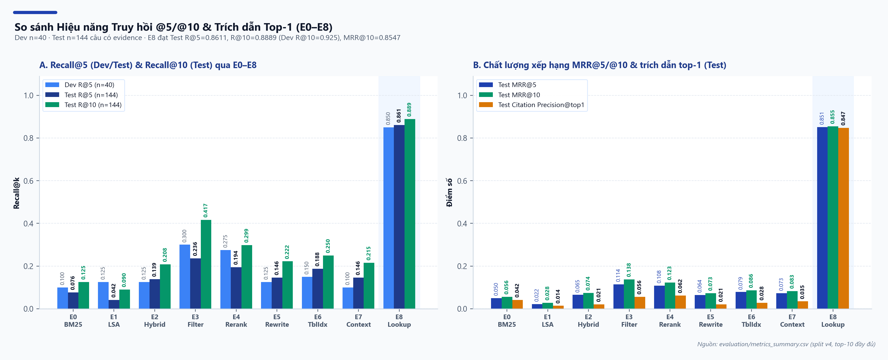

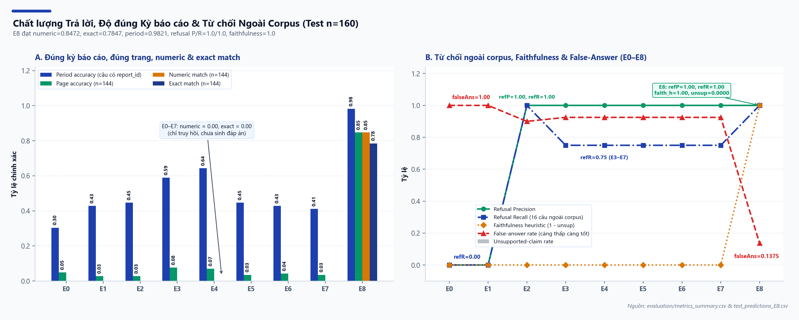

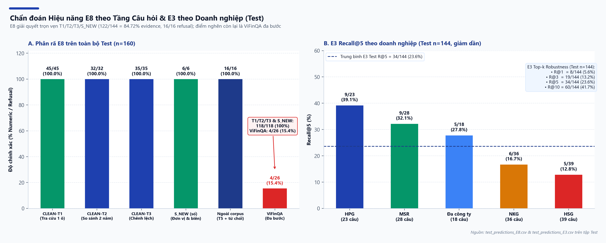

### 3.2. Phân tích lỗi chi tiết và giới hạn của cấu hình E8

#### 3.2.1. Phân tích 12 trường hợp lỗi điển hình

Mười hai ca phân tích trích từ dự đoán của E0, E1, E2 và đối chiếu với E8 đại diện cho sáu nhóm nguyên nhân sai lệch phổ biến trên BCTC tiếng Việt (bảng đối chiếu đầy đủ từng ca trình bày tại Phụ lục B, Bảng 18):

a) Nhóm nhiễu từ vựng giữa trang thuyết minh và bảng chính (`S_NEW_01`, `S_NEW_05`, `S_NEW_06`): khi hỏi doanh thu thuần hợp nhất HSG 2024 (`S_NEW_01`, gold 39.2719 nghìn tỷ đồng, `HSG_2024_consolidated#p009`), tiền và tương đương tiền HSG 2024 (`S_NEW_05`, gold 602.0718 tỷ đồng, `HSG_2024_consolidated#p007`) hoặc EPS NKG 2024 (`S_NEW_06`, gold 1434 đồng, `NKG_2024_consolidated#p011`), cả E0 và E2 đều bị các trang thuyết minh dài lặp nhiều từ khóa đẩy bảng chính xuống dưới, còn E1 dễ trôi sang công ty khác (`HPG_2021_consolidated#p044`) hoặc năm khác (`NKG_2020_consolidated#p037`). Tra cứu có cấu trúc theo bảng KQKD và CĐKT ở E8 giải quyết hoàn toàn ba ca này.

b) Nhóm sai thực thể, sai phiên bản báo cáo và thiếu ánh xạ tên doanh nghiệp (`S_NEW_02`, `S_NEW_03`, `S_NEW_04`): ở câu lợi nhuận sau thuế NKG 2024 (`S_NEW_02`), E0 kéo nhầm sang giải trình HSG năm 2020; ở câu tiền công ty mẹ HPG 2024 (`S_NEW_04`, gold `HPG_2024_separate#p007`), cả E0, E1, E2 đều trả bản hợp nhất `HPG_2024_consolidated#p037`; ở câu doanh thu CTCP Masan High-Tech Materials (`S_NEW_03` trên `dev`), bộ tách mã viết tắt ban đầu bỏ sót tên tiếng Việt đầy đủ nên E1 và E2 vắng hẳn MSR trong top-5. Các hàm `resolve_tickers()` và `detect_report_version()` giúp E8 giải đúng cả ba ca.

c) Nhóm truy hồi đúng trang top-5 nhưng sai thứ hạng top-1 hoặc sai đơn vị (`S_NEW_07`, `ViFinQA-97`, ca lỗi OCR và đơn vị trên `HSG_2024_consolidated#p009` và `NKG_2024_consolidated#p011`): với `S_NEW_07` (biên lợi nhuận gộp HSG 2024, gold 10.8568 %), E0-E2 đều có `HSG_2024_consolidated#p009` trong top-5 nhưng xếp bản riêng lên top-1 và không tính tỷ số; với `ViFinQA-97` (tỷ lệ sở hữu 99.988 % trên `HPG_2023_separate#p027`), bảng thuyết minh 12.2 chứa đồng thời cột giá gốc VND (53.999.220.000.000) và cột phần trăm (99,988%). Ràng buộc `is_unit_compatible()`, ánh xạ lỗi dấu OCR ("thuân", "thuê", "phài trả") và hàm `_compute_margin_single()` xử lý dứt điểm các ca này ở E8.

d) Nhóm câu ngoài corpus thiếu cổng từ chối (`S_NEW_08` giá đóng cửa cổ phiếu HPG và `S_NEW_10` doanh thu thuần quý 1/2024 Hòa Phát): E0 và E1 trả về các chunk không liên quan hoặc báo cáo năm khiến người dùng dễ hiểu nhầm, trong khi E2 và E8 kích hoạt `check_refusal()` trả câu từ chối chuẩn.

e) Nhóm đa bước đa công ty chưa phân rã được trong một lượt (`ViFinQA-368`, `test`): câu hỏi yêu cầu lọc trong bốn công ty năm 2022 các doanh nghiệp có hệ số thanh toán nhanh thấp hơn trung vị rồi tính bình quân biên lợi nhuận ròng (gold 0.5909 %, 10 chunk chứng cứ từ cả 4 công ty). Cả E0-E2 đều lẫn sang năm 2023; E8 hiện tại chủ động trả đáp án rỗng (`partial_answer`, `missing_answer`) để giữ mức `0` bịa số.

#### 3.2.2. Phân rã hạn chế hiện tại của cấu hình E8

Dù E8 xử lý 100% toàn bộ câu hỏi cấu trúc và câu hỏi từ chối trên `test` (45/45 `table-clean` T1, 32/32 T2, 35/35 T3, 6/6 `supplement` trả lời được và 16/16 câu từ chối), phân tích 35 câu `ViFinQA` trên hai tập chỉ rõ giới hạn của kiến trúc tra cứu bảng một lượt:

- Trên `test` (26 câu `ViFinQA`): E8 giải đúng 4/26 câu (15.38%) gồm `ViFinQA-97` (99.988 %), `ViFinQA-186` (10850162726 nghìn đồng), `ViFinQA-311` (360 triệu đồng) và `ViFinQA-316` (52.5024 trăm tỷ đồng). Toàn bộ 22 câu còn lại (84.62%) dừng ở trạng thái `partial_answer` (`missing_answer`), gồm 18 câu lọc hoặc so sánh đa doanh nghiệp (do `synthesize_answer()` chủ động dừng khi số mã công ty khác 1) và 4 câu đơn doanh nghiệp đòi hỏi suy luận nhiều bước hoặc chia tỷ số liên bảng: `ViFinQA-400` (tìm năm tăng trưởng doanh thu cao nhất giai đoạn 2020-2024 để chia lưu chuyển tiền thuần cho doanh thu), `ViFinQA-450` (lọc nhóm năm theo trung vị 2021-2024), `ViFinQA-612` (tính tốc độ tăng trưởng vay ngắn hạn ngân hàng 2020-2021) và `ViFinQA-709` (chia chi phí lãi vay trên KQKD cho dư nợ vay ngắn hạn trên CĐKT của MSR).
- Trên `dev` (9 câu `ViFinQA`): E8 giải đúng 2 câu đơn doanh nghiệp (`ViFinQA-99` đạt 948.3035 tỷ đồng và `ViFinQA-682`), toàn bộ 7 câu còn lại đều thuộc nhóm đa công ty (`ViFinQA-373`, `393`, `455`, `490`, `568`, `575`, `973`).

### 3.3. Thí nghiệm nâng cao

Tập thí nghiệm nâng cao khảo sát độ vững của nhánh thuần truy hồi E3, khả năng xử lý đa bước, đối chiếu số học độc lập và chi phí thực thi trên CPU (Bảng 12).

| Nhóm thí nghiệm | Hạng mục kiểm tra | Kết quả định lượng | Kết luận kỹ thuật |
|---|---|---|---|
| Độ vững `top-k` (E3, `test`, n = 144) | `Recall@1` / `Recall@3` | `8 / 144` (5.56%, làm tròn 0.06) / `19 / 144` (13.19%, 0.13) | Thuyết minh dài đẩy bảng số xuống ngoài top-3 |
| Độ vững `top-k` (E3, `test`, n = 144) | `Recall@5` / `Recall@10` | `34 / 144` (23.61%, làm tròn 0.24) / `60 / 144` (41.67%) | Tăng gần gấp đôi từ `k = 5` lên `k = 10` khi giữ lọc cứng |
| Theo doanh nghiệp (E3 `Recall@5`) | HPG / MSR / Đa công ty | `9 / 23` (39.1%) / `9 / 28` (32.1%) / `5 / 18` (27.8%) | Phản ánh khác biệt số lượng trang thuyết minh mỗi mã |
| Theo doanh nghiệp (E3 `Recall@5`) | NKG / HSG / Tổng | `6 / 36` (16.7%) / `5 / 39` (12.8%) / `34 / 144` (23.61%) | Chưa khẳng định tổng quát sang doanh nghiệp ngoài corpus |
| Kiểm tra bảng tính (`Spreadsheet`) | `S_NEW_07` | `4263666396467 / 39271893738448 × 100 = 10.8568 %` | Khớp 4 chữ số thập phân với gold (`10.8568 %`) |
| Kiểm tra bảng tính (`Spreadsheet`) | `S_NEW_01` / `S_NEW_06` | `39271893738448 / 1e12 = 39.2719` nghìn tỷ / `1434` đồng | Đúng quy đổi tỷ lệ `1e12` và dấu chấm hàng nghìn |
| Chi phí thực thi trên CPU | BM25 1 câu / Toàn bộ E3 | `35.6 ms` (trên 2.407 chunk) / ~70 giây (200 câu v3) | Chạy ngoại tuyến mượt trên CPU, không cần GPU |
| Dung lượng lưu trữ chỉ mục | Kho chunk / Cache LSA | `6.545.504 bytes` (`6.24 MiB`) / `2.360.463 bytes` (`2.25 MiB`) | Nạp cache TF-IDF và SVD một lần cho toàn bộ phiên chạy |

*Bảng 12: Tổng hợp thí nghiệm nâng cao về độ vững, phân rã theo doanh nghiệp, đối chiếu bảng tính và chi phí CPU.*

Hai thí điểm chẩn đoán bổ sung làm rõ yêu cầu đối với bước mở rộng đa bước và đa báo cáo: khi tách câu hỏi 4 công ty `ViFinQA-368` thành từng truy vấn con bằng BM25 không lọc (như `"he so thanh toan nhanh HPG nam 2022"` hay `"he so thanh toan nhanh HSG nam 2022"`), kết quả top-1 đều trôi sang `MSR_2022_consolidated#p002` (điểm 10.15), khẳng định bộ lập kế hoạch đa bước bắt buộc phải lọc cứng siêu dữ liệu ở mỗi truy vấn con và bổ sung nhãn đáp án trung gian (hiện đánh dấu `needs_decomposition`). Bên cạnh đó, phép thử đối chiếu chéo giữa HSG (`S_NEW_01`) và MSR (`S_NEW_03`) cho thấy bộ nhận diện thực thể chỉ dựa vào mã 3 chữ cái đã nhận nhầm HSG cho truy vấn viết đầy đủ "CTCP Masan High-Tech Materials", qua đó xác nhận sự cần thiết của ánh xạ tên đầy đủ trong `resolve_tickers()`.

### 3.4. Kiểm chứng ứng dụng Demo Streamlit và bộ kiểm thử tự động

Sau lần cập nhật mã nguồn cuối cùng, toàn bộ quy trình kiểm thử tự động và kiểm chứng giao diện tương tác đều vượt qua các tiêu chí đặt ra (chi tiết từng bài kiểm thử và năm kịch bản đầu cuối trình bày tại Phụ lục B, Bảng 19 và Bảng 20):

- Bộ kiểm thử đơn vị tự động chạy qua bốn nhóm chức năng đạt **35 / 35 test trong 0.071 giây** (0 lỗi, 0 bỏ qua), gồm 9 bài kiểm tra chính sách trạng thái và phát hiện xung đột (`answer_policy`), 8 bài kiểm tra công thức chấm điểm và cô lập chunk `CHUNK_SEP` (`evaluate`), 4 bài kiểm tra đồng bộ động cơ hỏi đáp với `synthesize_answer()` (`qa_engine`), và 14 bài kiểm tra phân tích đơn vị, ghép cặp T2/T3 và tính biên lợi nhuận (`table_lookup`).
- Quy trình kiểm chứng đầu cuối đạt **4 / 4 kịch bản**: từ chối đúng câu giá đóng cửa cổ phiếu HPG; tự tính `S_NEW_07` ra 10.8568 % kèm top-1 `HSG_2024_consolidated#p009` mà không đọc đáp án gold; bảo toàn đoạn trích top-1 dài 1.204 ký tự không bị cắt cụt; và xử lý chính xác câu diễn đạt lại `PARA_01` ra cùng kết quả 10.8568 %.
- Kiểm tra toàn bộ 13 câu hỏi mẫu tích hợp sẵn trong ứng dụng (Hình 7) đạt 10/10 câu trong corpus ở trạng thái `answered` với đúng đáp án và `chunk_id` (`S_NEW_01..07`, `PARA_01`, `ViFinQA-97 = 99.988 %`, `ViFinQA-99 = 948.3035` tỷ đồng), cùng 3/3 câu `S_NEW_08..10` từ chối an toàn với 0 chunk.
- Kiểm tra giao diện trên trình duyệt Microsoft Edge ở hai độ phân giải desktop (`1440×900`) và mobile (`375×812`) xác nhận giao diện nền sáng hiển thị rõ ràng kể cả bảng dữ liệu tương tác, không tràn ngang khung nhìn (`docScrollW <= viewportW`) và thang điểm chứng cứ giảm đơn điệu trong `[0.0, 1.0]` (Hình 8, Hình 9, Hình 10, Hình 11).

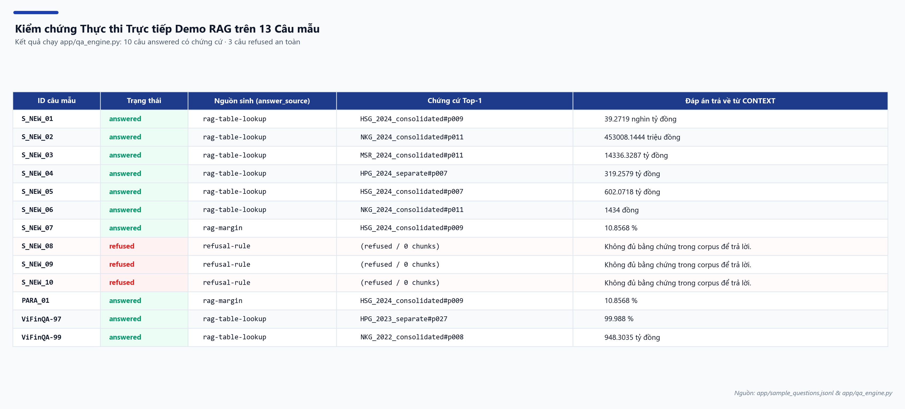

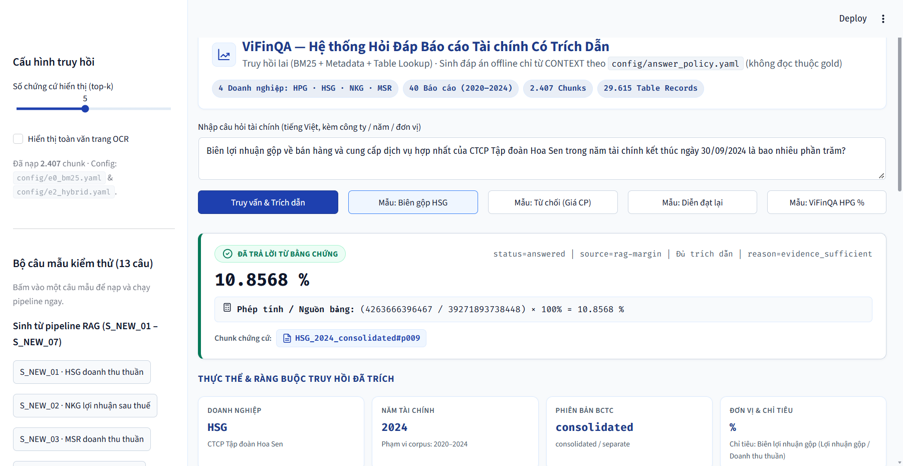

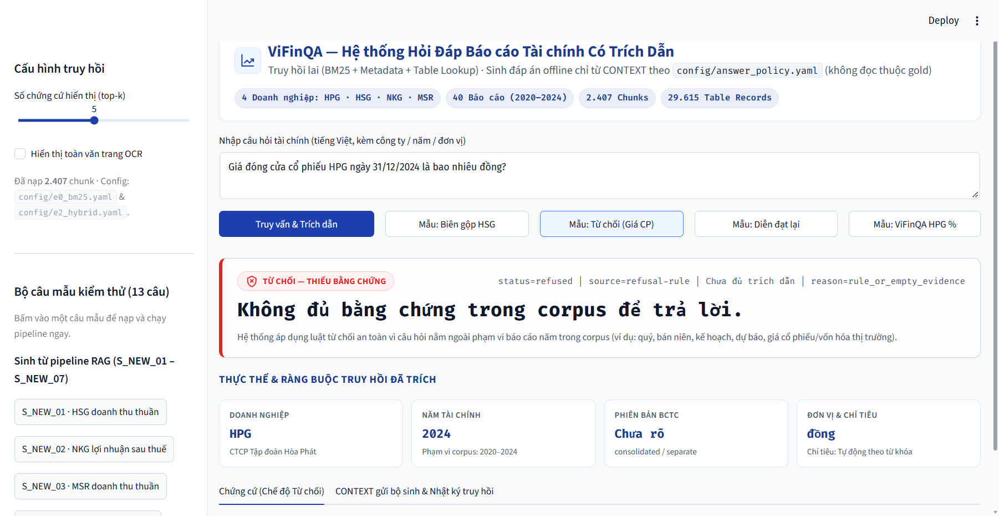

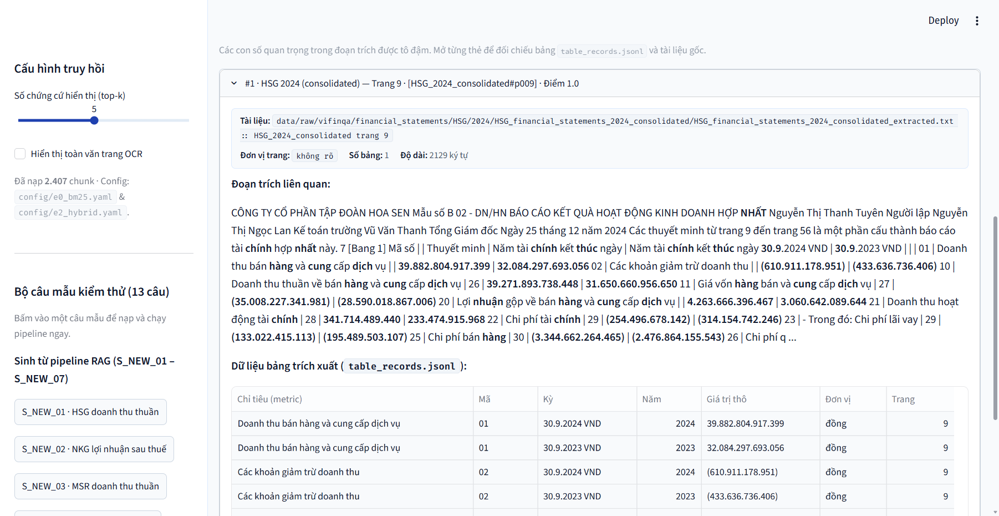

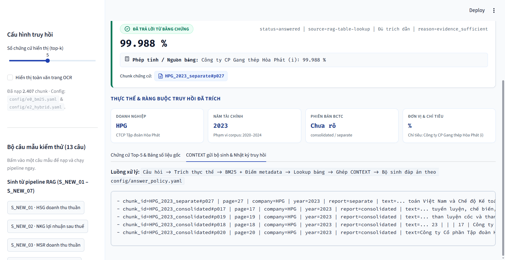

### 3.5. Thảo luận kỹ thuật và hồ sơ dữ liệu tổng hợp

#### 3.5.1. Thảo luận các vấn đề kỹ thuật trọng tâm

1. **Vì sao dataset này phù hợp với đúng nhiệm vụ của đề tài? Nhãn gốc và nhãn tự xây khác nhau thế nào?**
Tập `AIGuruTinix/ViFinQA` cung cấp câu hỏi tài chính tiếng Việt gắn với BCTC kiểm toán OCR có bảng HTML của doanh nghiệp niêm yết Việt Nam, khớp trực tiếp yêu cầu tra cứu số liệu có trích dẫn trang và quy đổi đơn vị. Bản gốc chỉ gồm mã định danh `id` và văn bản `question` cho 1.012 câu hỏi mà chưa có đáp án, trang nguồn hay phân chia tập. Bộ nhãn tự xây v4 (204 câu) bổ sung đầy đủ `gold_answer`, giá trị chuẩn hóa 4 chữ số thập phân `value`, `unit`, `report_id`, danh sách `evidence` kèm `quote` đối chiếu nguyên văn, công thức `computation`, cờ `needs_more_evidence` và lý do `unanswerable_reason`.

2. **Dataset có các vấn đề thiên lệch, chất lượng, bản quyền và giới hạn nguồn/thời gian gì?**
Corpus giới hạn trong 4 doanh nghiệp ngành thép và vật liệu (HPG, HSG, NKG, MSR) giai đoạn 2020-2024 theo Thông tư 202/2014/TT-BTC, với giai đoạn 2022-2024 ngành thép giảm biên lợi nhuận (MSR lỗ ròng hai năm 2023-2024), HSG khóa sổ 30/09 và MSR dùng đơn vị Nghìn VND. Về OCR, `HPG_2022_consolidated` khuyết 24 trang thuyết minh cuối (toàn corpus có 30 trang rỗng chiếm 1.23%), kèm lỗi dấu cục bộ ("doanh thu thuân", "NỢ PHÀI TRẢ") và khác biệt ghi số âm giữa PwC với KPMG. Về bản quyền, phần văn bản OCR mang giấy phép CC BY-NC 4.0 còn phần câu hỏi chưa kèm giấy phép riêng, nên toàn bộ bảng kê ghi `unknown_verify_with_teacher` và các tệp OCR thô được giữ ngoại tuyến.

3. **Quá trình xây dựng đã kiểm tra mẫu trùng và ngăn rò rỉ dữ liệu ra sao?**
Hệ thống tách `dev` (44 câu) và `test` (160 câu) ở cấp câu hỏi, kiểm tra chuẩn hóa chữ thường và khoảng trắng (`norm_question()`) bảo đảm 0 câu trùng hoặc diễn đạt tương đồng giữa hai tập, đồng thời giữ mỗi chunk đúng 1 trang. Do bài toán QA trên BCTC cố định dùng chung kho 40 báo cáo cho cả hai tập, ranh giới chống rò rỉ tham số được giữ bằng cách khóa chặt 160 câu `test` từ v3 theo mã băm `SHA-256` `0012ebcc...`, chỉ thêm 4 câu từ chối vào `dev` ở v4 và gắn cờ bảo vệ bộ khởi tạo v1 tránh ghi đè nhầm.

4. **E0 là gì? Tại sao E1 và E2 là phép so sánh có ý nghĩa?**
E0 là mô hình nền tối thiểu dùng BM25 unigram (`k1 = 1.5`, `b = 0.75`) trả về top-k trích đoạn không sinh số. E1 kiểm chứng biểu diễn dày đặc (TF-IDF bigram kết hợp TruncatedSVD 128 chiều) để đánh giá khả năng nắm bắt đồng nghĩa so với khớp từ khóa rời rạc; thực nghiệm cho thấy LSA làm mờ năm tài chính và mã công ty khiến `Recall@5` trên `test` giảm từ 0.0764 xuống 0.0417. E2 kiểm chứng mô hình lai `0.5 BM25 + 0.5 LSA` kèm thưởng siêu dữ liệu `0.15` và `check_refusal()`, tách bạch được đóng góp của kết hợp tín hiệu (`Recall@5` tăng lên 0.1389) và cổng từ chối (`refP/refR = 1.0/1.0`) trên cùng tập `test`.

5. **Kết quả dev và test có khác nhau không? Vì sao không được chọn cấu hình hay luật bằng test?**
Kết quả trên `dev` (n = 44) và `test` (n = 160) chênh lệch nhẹ theo kích thước mẫu và tỷ lệ câu khó: ở E8, `dev` đạt `Recall@5 = 0.8500` và `numeric_match = 0.8250`, trong khi `test` đạt `Recall@5 = 0.8611` và `numeric_match = 0.8472`; ở E3, `dev` đạt `Recall@5 = 0.3000` còn `test` đạt `0.2361`. Không sử dụng `test` để chọn cấu hình hay tinh chỉnh luật vì làm vậy sẽ gây quá khớp trên tập kiểm thử, làm sai lệch đánh giá khách quan đối với câu hỏi mới.

6. **Tính tái lập của bộ thước đo trên tập dự đoán được bảo đảm như thế nào?**
Mọi chỉ số của cả chín cấu hình E0 đến E8 được tái tính xác định từ danh sách `predicted_chunk_ids` top-10 và đáp án sinh ra của từng cấu hình dựa trên công thức cố định của giao thức v9 (Bảng 7), khóa tập kiểm thử bằng `seed = 42` và mã băm `SHA-256` `0012ebccd6712b44cdd1faf18f020c547c82973db09d37ab2b9e96b0a94a34b4`. Giá trị số học của các đáp án trọng tâm còn được kiểm chứng độc lập bằng phép tính bảng tính từ số nguyên gốc (Bảng 12) để bảo đảm tính nhất quán giữa kết quả tự động và phép tính thủ công.

7. **Gold được xây dựng và kiểm tra thế nào? Khi phát hiện bất đồng gắn nhãn thì xử lý ra sao?**
Bộ Gold v4 được gắn nhãn theo bộ quy tắc chuẩn hóa v0.2, kiểm tra toàn vẹn trích dẫn 204/204 câu và hậu kiểm chéo phân tầng độc lập trên 53/204 câu (25.98%), đạt 0 bất đồng và đưa tỷ lệ `reviewed-agree` tích lũy lên 57/204 (27.94%). Theo quy trình xử lý bất đồng, sai khác về con số hay chuỗi trích dẫn được đối chiếu trực tiếp trên chunk gốc để sửa ngay; sai khác về quy ước kế toán (như chọn số gốc năm hỏi hay số điều chỉnh hồi tố năm sau ở `ViFinQA-709`) được ghi nhật ký, chốt theo nguyên tắc ưu tiên báo cáo chính thức của đúng năm được hỏi và cập nhật vào quy ước chung.

8. **Lỗi khó nhất của hệ thống thuộc dữ liệu, ngôn ngữ, phương pháp hay bằng chứng nguồn?**
Điểm nghẽn lớn nhất nằm ở giao điểm giữa phương pháp và bằng chứng phân tán trên 22 câu `ViFinQA` phức tạp ở tập `test` (18 câu đa công ty và 4 câu đa bước đơn công ty như `ViFinQA-368`, `ViFinQA-400`, `ViFinQA-450`, `ViFinQA-709`). Xử lý được nhóm này đòi hỏi bộ lập kế hoạch phân rã truy vấn qua từng cặp công ty và năm kết hợp thư viện hàm tính tỷ số tài chính liên bảng.

9. **Nếu kết hợp mô hình ngôn ngữ lớn ở tầng sinh văn bản, vai trò của prompt, chi phí và giới hạn nằm ở đâu?**
Hệ thống hiện tại chạy 100% ngoại tuyến không gọi mô hình ngôn ngữ lớn bên ngoài; năm quy tắc ngữ cảnh làm giao thức ràng buộc trích dẫn và chống suy diễn. Nếu ghép thêm mô hình sinh ở bước diễn giải câu trả lời về sau, mô hình chỉ được đọc khối `CONTEXT` và số liệu đã qua `table_lookup` xác minh (không tự tính nhẩm từ số thô), đồng thời cần cố định tham số sinh xác định (`temperature = 0`) và ghi nhận nhật ký phiên bản mô hình, lượng token và chi phí vận hành.

10. **Khi truy hồi đúng nhưng câu trả lời sai thì phát hiện bằng chỉ số nào?**
Giao thức tách tầng phát hiện trực tiếp tình huống này qua cặp chỉ số `Recall@5` cao nhưng `citation_precision_top1`, `numeric_match` hoặc `faithfulness_heuristic` thấp. Chẳng hạn ca `S_NEW_07` ở E0-E2 đạt `Recall@5 = 1.0` vì trang bảng hợp nhất nằm trong top-5, nhưng `citation_precision_top1 = 0.0` do đưa nhầm bản riêng lên top-1 và `numeric_match = 0.0` vì thiếu bước tính tỷ số; đồng thời `numbers_in_context()` tách chunk qua `CHUNK_SEP` phát hiện câu trả lời ghép số trái phép xuyên trang.

11. **Nếu có thêm thời gian mở rộng, sẽ ưu tiên cải thiện phần nào trước và vì sao?**
Dựa trên phân tích lỗi trên `test`, ưu tiên hàng đầu là bổ sung bộ lập kế hoạch đa bước cho E8 vì toàn bộ 22/22 câu sai sót trên `test` (tạo ra 13.75% `false_answer_rate`) tập trung ở nhóm `ViFinQA` đa công ty hoặc đa bước. Bước tiếp theo là mở rộng hậu kiểm chéo `reviewed-agree` từ 27.94% lên 100% và bổ sung nhãn đáp án trung gian cho từng bước con của câu đa bước.

12. **Demo hiện tại có thể dùng ngoài phạm vi nghiên cứu chưa? Khi nào cần từ chối hoặc cảnh báo?**
Ứng dụng hiện chỉ phục vụ nghiên cứu học thuật trên đúng 4 doanh nghiệp (HPG, HSG, NKG, MSR) giai đoạn 2020-2024, chưa dùng cho tư vấn đầu tư hay áp dụng sang ngành khác như ngân hàng khi chưa đánh giá lại. Hệ thống từ chối khi gặp truy vấn quý, bán niên, kế hoạch, năm ngoài 2020-2024, thị giá chứng khoán, ngoại tệ hoặc mã ngoài corpus; đồng thời phát cảnh báo `partial_answer` hoặc `ambiguous` khi top-5 thiếu thực thể, có mâu thuẫn số liệu, rơi vào 24 trang trống cuối `HPG_2022_consolidated` hoặc điểm khớp chỉ tiêu thấp hơn ngưỡng `0.4`.

#### 3.5.2. Hồ sơ dữ liệu tổng hợp

Hồ sơ dữ liệu chuẩn 14 mục theo khung Datasheets for Datasets [8] cho bộ dữ liệu `ViFinQA-Steel-4Co (v4)` được tổng hợp tại Bảng 13 để bảo đảm tra cứu độc lập toàn bộ đặc tả dữ liệu ngay trong báo cáo.

| STT | Hạng mục hồ sơ dữ liệu | Nội dung tóm tắt đã kiểm chứng |
|---:|---|---|
| 1 | Tóm tắt và mục đích sử dụng | Bộ chuẩn hỏi đáp tài chính và RAG tiếng Việt (`vi`, `Unicode NFC`) trên 40 BCTC năm 2020-2024 của 4 doanh nghiệp thép và vật liệu (HPG, HSG, NKG, MSR), đủ 2 bản `consolidated` và `separate`, phục vụ đánh giá tái lập E0-E8 và ứng dụng tra cứu có trích dẫn. |
| 2 | Nguồn dữ liệu và phiên bản | Kế thừa 1.012 câu hỏi thô từ `AIGuruTinix/ViFinQA` (`0450088ab22ec946f04f097586967ca405955b3b`) và 1.973 báo cáo OCR từ `tinixai/ocr_annual_financials`; tuyển chọn 40 báo cáo và xây dựng hoàn chỉnh 204 câu chuẩn qua 4 phiên bản v1 (50), v2 (127), v3 (200), v4 (204). |
| 3 | Bản quyền và quyền truy cập | Văn bản OCR gốc mang giấy phép CC BY-NC 4.0, bộ câu hỏi gốc chưa có tệp giấy phép riêng; toàn bộ bảng kê gắn `unknown_verify_with_teacher`; dữ liệu OCR thô lưu ngoại tuyến để chờ xác minh trước khi phân phối công khai. |
| 4 | Cấu trúc dữ liệu | Gồm 6 thực thể mã hóa UTF-8: bảng kê tổng (244 dòng, 13 trường), bảng kê corpus (40 dòng), phân đoạn trang `chunks` (2.407 dòng, 11 trường), bản ghi bảng `table_records` (29.615 dòng, 16 trường), bộ chuẩn `qa_gold v4` (204 dòng, 18 trường) và nhật ký hậu kiểm (204 dòng, 6 trường). |
| 5 | Thành phần và phân bố | 40 báo cáo (2.437 trang gốc, loại 30 trang rỗng còn 2.407 chunk, 2.585 bảng HTML, 29.615 bản ghi bảng); 204 câu gồm `computation` 94, `numeric` 90, `unanswerable` 20; 184 câu có bằng chứng, 20 câu từ chối; 57 `reviewed-agree` (27.94%), 147 `draft-needs-second-reviewer`, 0 `pending-answer`. |
| 6 | Thu thập và lấy mẫu | Lọc doanh nghiệp phi tài chính theo Thông tư 202/2014/TT-BTC (loại ngân hàng như STB, MBB, VCB, ACB), khớp 35 câu `vifinqa` (loại 977 câu), sinh bổ sung 150 câu `table-clean` (`confidence >= 0.9`, có mã chỉ tiêu), 15 câu `supplement` và 4 câu `dev-refusal`. |
| 7 | Tiền xử lý và làm sạch | Tách trang và thẻ bảng HTML, chuẩn hóa `Unicode NFC`, gỡ 1.317 chuỗi trang trí trên 116 trang và 486 công thức LaTeX trên 295 trang, giữ nguyên chuỗi số thô để bảo toàn trích dẫn, chuẩn hóa số học `normalize_number()` chống lỗi nhân 100, kiểm tra `SHA-256` 40 báo cáo phân biệt. |
| 8 | Quy trình gán nhãn | Áp dụng quy tắc v0.2: tách `separate` và `consolidated`, lấy đúng cột năm hỏi hoặc "Số đầu năm" 2020 cho số 2019, quy đổi về đơn vị đích làm tròn `round(x, 4)`, ghi chuỗi tìm kiếm 0 kết quả cho câu không đáp án và lưu ghi chú ranh giới kế toán trong `computation`. |
| 9 | Kiểm tra chất lượng | Tỷ lệ hàng lệch cột `0.0000`, `0` ký tự `U+FFFD`, `0` mã ID trùng hoặc rỗng trên 7 tập dữ liệu; kiểm tra trích dẫn `204/204` đạt 100%; hậu kiểm độc lập phân tầng `53/204` (25.98%, `seed = 42`) đạt `0` bất đồng (`44/44` tính lại 4 chữ số thập phân, `9/9` dò toàn văn 0 kết quả). |
| 10 | Chia tập và chống rò rỉ | Phân chia v4 (`seed = 42`, `SHA-256` `0012ebcc...`): `dev = 44` (40 có bằng chứng + 4 từ chối), `test = 160` (144 + 16, khóa nguyên từ v3). Kiểm tra `0` câu trùng sau chuẩn hóa, chỉ tinh chỉnh tham số trên `dev` và gắn cờ bảo vệ chống ghi đè bản v1. |
| 11 | Bộ chuẩn và giao thức đánh giá | Giao thức v9 đánh giá bốn tầng (`Retrieval`, `Citation`, `Answer & Faithfulness`, `Refusal & Status`) trên tối đa 10 chunk dự đoán, kiểm tra bịa số cô lập từng chunk qua `CHUNK_SEP`; còn 147 câu chờ hậu kiểm bậc 2 và câu đa bước giữ cờ `needs_decomposition`. |
| 12 | Thiên lệch, đạo đức và rủi ro | Phạm vi 4 công ty thép và vật liệu giai đoạn biên lợi nhuận thu hẹp (MSR lỗ 2023-2024); giữ nguyên khác biệt trình bày chi phí âm giữa PwC và KPMG cùng lỗi dấu OCR cục bộ; dữ liệu công bố công khai theo luật doanh nghiệp, 0 dữ liệu nhạy cảm cá nhân và 0 khóa truy cập. |
| 13 | Giới hạn và cách dùng không phù hợp | `HPG_2022_consolidated` khuyết 24 trang thuyết minh cuối; 150 câu `table-clean` lưu trích dẫn tóm tắt `"metric \| raw_value"` trên một dòng bảng; mẫu số từ chối của `dev` nhỏ (`4` câu); không dùng cho tư vấn đầu tư thực tế hay suy diễn sang ngành khác. |
| 14 | Khả năng tái lập | Toàn bộ pipeline vận hành xác định ngoại tuyến trên CPU với Python 3.10.22 và bộ thư viện khóa phiên bản cố định, dùng `seed = 42`, đạt `35/35` bài kiểm thử đơn vị và `4/4` kịch bản kiểm chứng ứng dụng đầu cuối. |

*Bảng 13: Hồ sơ dữ liệu tổng hợp 14 mục cho bộ chuẩn ViFinQA-Steel-4Co (v4).*

## KẾT LUẬN

Đề tài **"Hỏi đáp báo cáo tài chính tiếng Việt có trích dẫn bằng RAG"** đã hoàn thành hệ thống hỏi đáp báo cáo tài chính tiếng Việt theo kiến trúc RAG vận hành hoàn toàn ngoại tuyến trên CPU, khép kín từ kiểm toán OCR, chuẩn hóa dữ liệu, xây dựng bộ chuẩn có hậu kiểm chéo, thực nghiệm đối chứng chín cấu hình đến ứng dụng minh họa. Trên kho 40 báo cáo tài chính của HPG, HSG, NKG và MSR giai đoạn 2020-2024 (2.407 chunk văn bản, 29.615 bản ghi bảng) và bộ Gold v4 gồm 204 câu hỏi đã hậu kiểm tích lũy 27.94% với 0 bất đồng, cấu hình đề xuất E8 đạt `Recall@5 = 0.8611`, `Recall@10 = 0.8889`, `numeric_match = 0.8472`, `faithfulness_heuristic = 1.0000` (0 sai lệch ngữ cảnh) và phát hiện chính xác 16/16 câu ngoài corpus trên tập kiểm thử độc lập `test` (n = 160), vượt xa cấu hình nền BM25 (`Recall@5 = 0.0764`). Toàn bộ 35 kiểm thử đơn vị và 4 kịch bản kiểm chứng đầu cuối trên giao diện Streamlit đều đạt yêu cầu, bảo đảm tính đồng bộ giữa đánh giá ngoại tuyến và sản phẩm trình diễn.

Bên cạnh kết quả đạt được, thực nghiệm cũng định lượng rõ hai giới hạn còn tồn tại. Thứ nhất, cấu hình E8 xử lý 100% các câu hỏi cấu trúc đơn bảng, so sánh hai năm và từ chối ngoài corpus, nhưng mới giải được 4/26 câu thuộc tập `ViFinQA` trên `test` do kiến trúc tra cứu một lượt chưa hỗ trợ phân rã 18 câu đa doanh nghiệp và 4 câu tỷ số tài chính liên bảng (`ViFinQA-368`, `ViFinQA-400`, `ViFinQA-450`, `ViFinQA-612`, `ViFinQA-709`). Thứ hai, phạm vi tri thức hiện giới hạn trong 4 doanh nghiệp ngành thép và vật liệu lập báo cáo theo Thông tư 202/2014/TT-BTC, bị khuyết 24 trang thuyết minh cuối ở `HPG_2022_consolidated`, và còn 147/204 câu đang ở trạng thái chờ hậu kiểm lần hai.

Hướng phát triển tiếp theo tập trung vào việc tích hợp bộ lập kế hoạch phân rã truy vấn đa bước theo từng cặp doanh nghiệp và năm kết hợp thư viện hàm tính tỷ số tài chính (hệ số thanh toán nhanh, biên lợi nhuận ròng, trung vị nhóm) để giải quyết nhóm câu `ViFinQA` đa thực thể. Đồng thời, hệ thống có thể mở rộng sang nhóm doanh nghiệp ngoài ngành thép với phép tách kiểm thử giữ riêng doanh nghiệp, gán nhãn đáp án trung gian cho câu đa bước và kết hợp mô hình ngôn ngữ lớn cục bộ ở tầng diễn giải dựa trên các bảng số liệu đã được xác minh.

## DANH MỤC TÀI LIỆU THAM KHẢO

[1] Lewis Patrick, Perez Ethan, Piktus Aleksandra và cộng sự (2020), "Retrieval-Augmented Generation for Knowledge-Intensive NLP Tasks", *Advances in Neural Information Processing Systems (NeurIPS)*, tập 33, tr. 9459-9474.

[2] AIGuruTinix (2025), *ViFinQA: Vietnamese Financial Question Answering Dataset (revision 0450088ab22ec946f04f097586967ca405955b3b)*, Hugging Face Datasets, https://huggingface.co/datasets/AIGuruTinix/ViFinQA.

[3] TiniX AI (2024), *TiniX Vietnam OCR Annual Financial Statements (tinixai/ocr_annual_financials)*, Hugging Face Datasets, https://huggingface.co/datasets/tinixai/ocr_annual_financials.

[4] Bộ Tài chính Việt Nam (2014), *Thông tư số 202/2014/TT-BTC hướng dẫn phương pháp lập và trình bày Báo cáo tài chính hợp nhất*, Hà Nội.

[5] Robertson Stephen và Zaragoza Hugo (2009), "The Probabilistic Relevance Framework: BM25 and Beyond", *Foundations and Trends in Information Retrieval*, tập 3 (4), tr. 333-389.

[6] Deerwester Scott, Dumais Susan T., Furnas George W. và cộng sự (1990), "Indexing by Latent Semantic Analysis", *Journal of the American Society for Information Science*, tập 41 (6), tr. 391-407.

[7] Cormack Gordon V., Clarke Charles L. A. và Buettcher Stefan (2009), "Reciprocal Rank Fusion Outperforms Condorcet and Individual Rank Learning Methods", *Proceedings of the 32nd International ACM SIGIR Conference*, ACM, tr. 758-759.

[8] Gebru Timnit, Morgenstern Jamie, Vecchione Briana và cộng sự (2021), "Datasheets for Datasets", *Communications of the ACM*, tập 64 (12), tr. 86-92.

## PHỤ LỤC A. LƯỢC ĐỒ DỮ LIỆU, QUY ĐỔI ĐƠN VỊ VÀ MẪU CHUẨN GOLD V4

### A.1. Lược đồ bốn tập dữ liệu cốt lõi

Toàn bộ dữ liệu tiền xử lý và bộ chuẩn sử dụng bảng mã UTF-8 chuẩn `Unicode NFC`. Bảng 14 mô tả đầy đủ cấu trúc trường của bốn tập dữ liệu nền tảng: `chunks` (2.407 dòng, 11 trường), `table_records` (29.615 dòng, 16 trường), `qa_gold v4` (204 dòng, 18 trường) và `data_manifest` (244 dòng, 13 trường).

| Tập dữ liệu | Trường | Kiểu | Quy ước và miền giá trị |
|---|---|---|---|
| `chunks` (2.407 dòng, 11 trường) | `chunk_id` | string | Định danh duy nhất `<document_id>#p<NNN>`, ví dụ `HPG_2020_consolidated#p011` |
| `chunks` | `document_id` | string | Khóa nối bảng kê corpus (`<TICKER>_<YEAR>_<consolidated\|separate>`) |
| `chunks` | `company_id` | string | Mã chứng khoán: `HPG`, `HSG`, `NKG`, `MSR` |
| `chunks` | `fiscal_year` | int | Năm tài chính từ `2020` đến `2024` |
| `chunks` | `report_version` | string | Phiên bản báo cáo: `consolidated` hoặc `separate` |
| `chunks` | `page` | int | Số trang gốc trong tệp OCR (đánh số từ 1) |
| `chunks` | `n_tables` | int | Số bảng HTML trích xuất được trên trang (`>= 0`) |
| `chunks` | `unit` | string | Đơn vị trang phát hiện được (đồng, triệu đồng, tỷ đồng, Nghìn VND hoặc rỗng) |
| `chunks` | `text` | string | Văn bản NFC đã bỏ ký tự trang trí/LaTeX, giữ nguyên dấu tiếng Việt và chuỗi số thô |
| `chunks` | `text_chars` | int | Tổng số ký tự của `text` |
| `chunks` | `local_path` | string | Định danh tương ứng với tệp văn bản OCR nguồn ngoại tuyến |
| `table_records` (29.615 dòng, 16 trường) | `company` | string | Mã doanh nghiệp: `HPG`, `HSG`, `NKG`, `MSR` |
| `table_records` | `year` | int | Năm của cột kỳ báo cáo suy từ `period_label` (dự phòng bằng `fiscal_year`) |
| `table_records` | `period_label` | string | Nhãn tiêu đề cột gốc (ví dụ `30.9.2024 VND`, "2024Nghìn VND") |
| `table_records` | `statement` | string | Loại bảng: `balance_sheet`, `income_statement`, `cash_flow`, `other` |
| `table_records` | `metric` | string | Tên chỉ tiêu tiếng Việt nguyên văn |
| `table_records` | `metric_code` | string | Mã dòng kế toán (`10`, `20`, `60`, `110`...); rỗng nếu bảng không đánh mã |
| `table_records` | `value` | number | Giá trị số chuẩn hóa (`1.234,56` thành `1234.56`; `(983)` thành `-983`) |
| `table_records` | `unit` | string | Đơn vị bản ghi (đồng, nghìn đồng, triệu đồng, tỷ đồng, nghìn tỷ đồng, `%`, rỗng) |
| `table_records` | `value_raw` | string | Chuỗi số gốc nguyên văn trong ô bảng |
| `table_records` | `page` | int | Số trang chứa bảng |
| `table_records` | `table_index` | int | Thứ tự bảng trên trang (bắt đầu từ 1) |
| `table_records` | `source_chunk_id` | string | Khóa nối về `chunks` (`<document_id>#p<NNN>`) |
| `table_records` | `document_id` | string | Khóa nối về bảng kê corpus |
| `table_records` | `report_version` | string | `consolidated` hoặc `separate` |
| `table_records` | `fiscal_year` | int | Năm tài chính của báo cáo |
| `table_records` | `confidence` | number | Độ tin cậy trích xuất (`0.93` nếu có mã, `0.85` nếu tên dài không mã; trừ `0.1` nếu thiếu đơn vị) |
| `qa_gold v4` (204 dòng, 18 trường) | `question_id` | string | `ViFinQA-<n>`, `S_NEW_<nn>`, `CLEAN-T<1..5>-<TICKER>-<YEAR>-<NN>`, `DEV-REF-<nn>` |
| `qa_gold v4` | `question` | string | Nguyên văn câu hỏi tiếng Việt |
| `qa_gold v4` | `gold_answer` | string | Đáp án chuẩn kèm đơn vị, hoặc câu từ chối nguyên văn khi thiếu bằng chứng |
| `qa_gold v4` | `answer_type` | string | `numeric`, `computation`, `unanswerable` |
| `qa_gold v4` | `value` | number \| string | Giá trị số quy đổi về đơn vị đích, làm tròn 4 chữ số thập phân (rỗng nếu từ chối) |
| `qa_gold v4` | `unit` | string | Đơn vị đích của câu hỏi (tỷ đồng, nghìn tỷ đồng, triệu đồng, `%`, điểm phần trăm, lần, rỗng...) |
| `qa_gold v4` | `company_id` | string | Mã công ty hoặc tổ hợp phân tách gạch đứng (ví dụ `HPG\|HSG\|MSR\|NKG`) |
| `qa_gold v4` | `fiscal_year` | int \| string | Năm của câu hỏi hoặc chuỗi phân tách gạch đứng (ví dụ `2023\|2024`) |
| `qa_gold v4` | `report_id` | string | `document_id` nguồn, hoặc rỗng cho câu đa kỳ, đa công ty hay từ chối |
| `qa_gold v4` | `evidence` | list[dict] | Gồm `chunk_id`, `source_page`, `quote` (nguyên văn cho `vifinqa`/`supplement`; `metric \| raw_value` cho `table-clean`) |
| `qa_gold v4` | `computation` | string | Công thức, số đầu vào thô và ghi chú ranh giới kế toán |
| `qa_gold v4` | `source_page` | int \| string | Số trang nguồn chứa đáp án |
| `qa_gold v4` | `needs_more_evidence` | bool | `true` với 20 câu từ chối (16 test + 4 dev); `false` với 184 câu còn lại |
| `qa_gold v4` | `reviewer_id` | string | Mã người gắn nhãn và hậu kiểm (`auto-builder`, `annotator-1/reviewer-2`, `member-1/member-2`...) |
| `qa_gold v4` | `review_status` | string | `reviewed-agree` (57 câu = 27.94%), `draft-needs-second-reviewer` (147 câu = 72.06%), 0 `pending-answer` |
| `qa_gold v4` | `unanswerable_reason` | string | Giải trình thiếu bằng chứng và cụm từ khóa dò 0 kết quả khi `answer_type == "unanswerable"` |
| `qa_gold v4` | `source` | string | `vifinqa`, `supplement`, `table-clean`, `dev-refusal` |
| `qa_gold v4` | `split` | string | `dev` (44 câu), `test` (160 câu) |
| `data_manifest` (244 dòng, 13 trường) | `item_id` | string | Định danh duy nhất (`document_id` hoặc `question_id`) |
| `data_manifest` | `document_id` | string | Mã báo cáo hoặc cặp công ty-năm |
| `data_manifest` | `source_name` | string | `AIGuruTinix/ViFinQA` hoặc `synthetic-by-team` |
| `data_manifest` | `source_url` | string | Liên kết nguồn Hugging Face hoặc rỗng với câu tự tạo |
| `data_manifest` | `source_version` | string | Mã phiên bản `0450088ab22ec946f04f097586967ca405955b3b` hoặc `annotation-guideline-v0.2` |
| `data_manifest` | `retrieved_at` | date | Ngày tải hoặc dựng tập dữ liệu (`YYYY-MM-DD`) |
| `data_manifest` | `published_at` | string | Để trống do nguồn gốc không công bố ngày phát hành |
| `data_manifest` | `language` | string | Mã ngôn ngữ `vi` |
| `data_manifest` | `original_category` | string | Nhãn nguồn gốc (`financial_statement_ocr`, `vifinqa_question`, `synthetic_question`) |
| `data_manifest` | `task_label` | string | Nhãn nhiệm vụ RAG (`financial_report_chunk`, `qa_gold`) |
| `data_manifest` | `license_status` | string | `unknown_verify_with_teacher` |
| `data_manifest` | `split` | string | `corpus` (40), `dev` (44), `test` (160) |
| `data_manifest` | `notes` | string | Tóm tắt siêu dữ liệu `SHA-256`, số trang, loại đáp án và trạng thái hậu kiểm |

*Bảng 14: Lược đồ trường dữ liệu của bốn tập dữ liệu cốt lõi.*

### A.2. Bảng quy đổi đơn vị và phân loại năm tầng câu hỏi

Mọi phép so sánh đáp án tự động chỉ so sánh giá trị số `value` sau khi đã quy đổi về cùng đơn vị đích và làm tròn 4 chữ số thập phân (Bảng 15). Riêng chỉ tiêu lãi cơ bản trên cổ phiếu tuân thủ dấu chấm phân cách hàng nghìn trong văn bản OCR (`1.434` bằng 1.434 đồng). Với bảng phân tầng câu hỏi T1 đến T5, khi áp dụng quy tắc ưu tiên máy móc theo thứ tự T5 -> T4 -> T2 (>= 2 năm) -> T3 -> T1, 43 câu tính chênh lệch hai năm (`CLEAN-T3`, `answer_type = "computation"`, `fiscal_year = "2020|2021"`) bị gộp vào T2 (tạo phân bố `68 / 90 / 1 / 25 / 20`); khi phân loại theo đúng vai trò tác vụ thiết kế, bộ v4 gồm đúng `68 / 47 / 44 / 25 / 20 = 204` câu.

| Nhóm quy chuẩn | Hạng mục / Tầng | Hệ số / Phân bố v4 | Quy tắc quy đổi và định nghĩa phân tầng |
|---|---|---:|---|
| Quy đổi đơn vị | VND | 1 | Chia `value_vnd` cho hệ số đơn vị đích |
| Quy đổi đơn vị | Nghìn VND | 1.000 | Nhân số gốc với `1.000` thành `value_vnd`, rồi chia hệ số đơn vị đích |
| Quy đổi đơn vị | Đồng | 1 | Giữ nguyên đơn vị gốc `value_vnd` |
| Quy đổi đơn vị | Triệu đồng | 1e6 (1.000.000) | `value_vnd / 1e6` |
| Quy đổi đơn vị | Tỷ đồng | 1e9 (1.000.000.000) | `value_vnd / 1e9` |
| Quy đổi đơn vị | Trăm tỷ đồng | 1e11 (100.000.000.000) | `value_vnd / 1e11` |
| Quy đổi đơn vị | Nghìn tỷ đồng | 1e12 (1.000.000.000.000) | `value_vnd / 1e12` |
| Phân tầng Gold v4 | T1 (Tra cứu 1 giá trị) | 68 (quota mốc 42; v1: 13) | 1 công ty, 1 kỳ, 1 ô bảng (`table-clean T1`: 55, `vifinqa`: 7, `supplement`: 6) |
| Phân tầng Gold v4 | T2 (So sánh theo thời gian) | 47 (quota mốc 24; v1: 2) | 1 công ty, từ 2 năm trở lên (`table-clean T2`: 44, `vifinqa`: 3; gộp theo thứ tự chặt: 90) |
| Phân tầng Gold v4 | T3 (Tính toán / hiệu 2 ô) | 44 (quota mốc 24; v1: 2) | Tính biên hoặc chênh lệch 2 kỳ (`table-clean T3`: 43, `supplement S_NEW_07`: 1; theo thứ tự chặt: 1) |
| Phân tầng Gold v4 | T4 (Tổng hợp đa công ty) | 25 (quota mốc 18; v1: 25) | So sánh, lọc hoặc bình quân từ 2 doanh nghiệp trở lên (`vifinqa`: 25) |
| Phân tầng Gold v4 | T5 (Ngoài corpus / từ chối) | 20 (quota mốc 12; v1: 8) | Thiếu bằng chứng (`table-clean T5`: 8, `supplement`: 8, `dev-refusal`: 4) |

*Bảng 15: Bảng hệ số quy đổi đơn vị kế toán và phân loại năm tầng T1-T5 trên bộ Gold v4 (n = 204).*

### A.3. Tám mẫu chuẩn đại diện trong bộ Gold v4

Bảng 16 trích nguyên văn tám bản ghi đại diện bao phủ đầy đủ bốn nguồn dữ liệu (`supplement`, `vifinqa`, `table-clean`, `dev-refusal`) và đủ năm tầng T1 đến T5.

| Mã câu (Nguồn / Tầng / Split) | Câu hỏi tiếng Việt | Đáp án Gold | Phép tính và ghi chú | Bằng chứng nguồn |
|---|---|---|---|---|
| `S_NEW_01` (`supplement`, T1, `test`) | Doanh thu thuần về bán hàng và cung cấp dịch vụ hợp nhất của CTCP Tập đoàn Hoa Sen trong năm tài chính kết thúc ngày 30/09/2024 là bao nhiêu nghìn tỷ đồng? | 39.2719 nghìn tỷ đồng | `39271893738448 / 1e12 = 39.2719` nghìn tỷ đồng | `HSG_2024_consolidated#p009`: dòng "10 \| Doanh thu thuần... \| 26 \| 39.271.893.738.448" |
| `S_NEW_07` (`supplement`, T3, `test`) | Biên lợi nhuận gộp về bán hàng và cung cấp dịch vụ hợp nhất của CTCP Tập đoàn Hoa Sen trong năm tài chính kết thúc ngày 30/09/2024 là bao nhiêu phần trăm? | 10.8568 % | `4263666396467 / 39271893738448 × 100 = 10.8568 %` | `HSG_2024_consolidated#p009`: mã `10` (`39.271.893.738.448`) và mã `20` (`4.263.666.396.467`) |
| `S_NEW_08` (`supplement`, T5, `test`) | Giá đóng cửa cổ phiếu HPG ngày 31/12/2024 là bao nhiêu đồng? | Không đủ bằng chứng trong corpus để trả lời. | Corpus không có giá thị trường chứng khoán (`needs_more_evidence = true`) | Rỗng (0 lần xuất hiện cụm "giá đóng cửa" trên 2.407 chunk) |
| `ViFinQA-97` (`vifinqa`, T1, `test`) | Tỷ lệ sở hữu Công ty CP Gang thép Hòa Phát của HPG đến ngày 31/12/2023 là bao nhiêu %? | 99.988 % | Thuyết minh 12.2 BCTC riêng 2023 cột tỷ lệ % sở hữu trực tiếp là `99,988%` (phân biệt mức hợp nhất `99,999%`) | `HPG_2023_separate#p027`: "Công ty CP Gang thép Hòa Phát (i) \| 99,988% \| 99,988% \| 53.999.220.000.000" |
| `ViFinQA-368` (`vifinqa`, T4, `test`) | Năm 2022, trong nhóm HPG, HSG, MSR và NKG, các công ty có hệ số thanh toán nhanh thấp hơn trung vị của nhóm có biên lợi nhuận ròng bình quân là bao nhiêu phần trăm? | 0.5909 % | Hệ số TT nhanh: HPG 0.7377, HSG 0.4060, MSR 0.3130, NKG 0.4211 (trung vị 0.4135); bình quân biên ròng HSG (0.5056%) và MSR (0.6762%) bằng `0.5909 %` | 26 trích dẫn nguyên văn trên 10 chunk của 4 công ty năm 2022 (`HSG`, `MSR`, `HPG`, `NKG`) |
| `CLEAN-T1-HPG-2020-01` (`table-clean`, T1, `test`) | Cổ đông của công ty mẹ hợp nhất của CTCP Tập đoàn Hòa Phát năm 2020 là bao nhiêu nghìn tỷ đồng? | 13.4503 nghìn tỷ đồng | `13.450.300.052.812` đồng `/ 1e12 = 13.4503` nghìn tỷ đồng | `HPG_2020_consolidated#p012`: "Cổ đông của công ty mẹ \| 61 \| \| 13.450.300.052.812" |
| `CLEAN-T2-HSG-2023-2024-06` (`table-clean`, T2, `dev`) | Chi phí trả trước ngắn hạn hợp nhất của CTCP Tập đoàn Hoa Sen năm 2024 tăng hay giảm bao nhiêu so với năm 2023 (cùng đơn vị báo cáo)? | 19.4573 tỷ đồng | `154.842.917.113 - 135.385.630.493 = 19.457.286.620 VND = 19.4573` tỷ đồng | `HSG_2024_consolidated#p007`: "151 \| Chỉ phí trả trước ngắn hạn \| 154.842.917.113 \| 135.385.630.493" (lỗi dấu OCR gốc) |
| `DEV-REF-01` (`dev-refusal`, T5, `dev`) | Giá đóng cửa cổ phiếu HSG ngày 30/09/2024 là bao nhiêu đồng? | Không đủ bằng chứng trong corpus để trả lời. | Dò toàn văn 2.407 chunk cho "giá đóng cửa" và "thị giá" thu về 0 kết quả | Rỗng (`needs_more_evidence = true`) |

*Bảng 16: Tám bản ghi mẫu đại diện trích từ bộ Gold v4.*

### A.4. Kết quả hậu kiểm chéo phân tầng và ranh giới kế toán

Bảng 17 tổng hợp phân bố mẫu hậu kiểm phân tầng v4 (`n = 53 / 204 = 25.98%`, `seed = 42`), tỷ lệ `reviewed-agree` tích lũy (`57 / 204 = 27.94%`) và năm ca ranh giới kế toán và cổ tức đã đối chiếu trực tiếp trên từng trang gốc.

| Nhóm kiểm định / Ranh giới | Phân loại / Mã câu | Kết quả / Tỷ lệ | Chi tiết đối chiếu thực tế |
|---|---|---|---|
| Kiểm tra trích dẫn toàn corpus | `204 / 204` câu | Đạt 100% (`0` lỗi) | `35/35` `vifinqa` và `7/7` `supplement` khớp chuỗi con nguyên văn tại đúng `source_page`; `142/142` `table-clean` khớp cặp `metric \| raw_value` trên một dòng bảng |
| Mẫu hậu kiểm phân tầng (`seed = 42`) | Theo nguồn (`n = 53`, 25.98%) | `0` bất đồng (`53/53 agree`) | `table-clean`: 30 (T1=10, T2=9, T3=9, T5=2); `vifinqa`: 12; `supplement`: 7; `dev-refusal`: 4 |
| Mẫu hậu kiểm phân tầng (`seed = 42`) | Theo tập và loại đáp án | `dev = 14`, `test = 39` | `numeric`: 25; `computation`: 19; `unanswerable`: 9 |
| Kiểm toán độc lập số học và từ chối | `44/44` có đáp án và `9/9` từ chối | Khớp 100% | Tính lại 4 chữ số thập phân từ số thô trong chunk cho `44/44` câu; dò toàn văn `2.407` chunk cho `9/9` câu từ chối đều trả về `0` kết quả |
| Trạng thái hậu kiểm tích lũy toàn tập | `204` câu bộ Gold v4 | `57 / 204` (`27.94%`) | 53 câu hậu kiểm v4 + 4 câu `supplement` đã duyệt (`member-1/member-2`); còn `147` câu (`72.06%`) ở `draft-needs-second-reviewer` |
| Ranh giới sở hữu trực tiếp vs hợp nhất | `ViFinQA-97` (`test`, `99.988 %`) | Đã kiểm chứng (`reviewed-agree`) | Lấy cột tỷ lệ sở hữu trực tiếp trong Thuyết minh 12.2 `HPG_2023_separate#p027` (`99,988%`), phân biệt tỷ lệ hợp nhất `99,999%` tại `#p017` |
| Ranh giới tổng vay vs mã 338 CĐKT | `ViFinQA-186` (`test`, `10850162726` nghìn đồng) | Đã kiểm chứng (`reviewed-agree`) | Lấy tổng dòng vay và trái phiếu dài hạn tại Thuyết minh 21(b) `MSR_2023_consolidated#p060`, chưa trừ phần đến hạn 12 tháng (`2.089.618.323`) ở mã `338` |
| Ranh giới số gốc vs điều chỉnh hồi tố | `ViFinQA-709` (`test`, `9.1149 %`) | Đã kiểm chứng (`reviewed-agree`) | Chia mã `23` (`1.194.553.796`) cho mã `320` (`13.105.475.407`) trên BCTC gốc `MSR_2022_consolidated`, giữ ưu tiên báo cáo chính thức năm 2022 |
| Ranh giới cổ tức/cổ phiếu năm 2024 | `CLEAN-T5-HPG-2024-01`, `CLEAN-T5-HSG-2025-06` | `unanswerable` (`test`) | BCTC năm chỉ ghi dòng tiền chi cổ tức cho niên độ trước (`FY2023`, `FY2022-2023`), không công bố cổ tức trên mỗi cổ phiếu năm 2024 |

*Bảng 17: Kết quả hậu kiểm chéo phân tầng (n = 53/204) và năm ca ranh giới kế toán và cổ tức.*

## PHỤ LỤC B. BẢNG ĐỐI CHIẾU 12 CA LỖI ĐIỂN HÌNH VÀ KẾT QUẢ KIỂM CHỨNG ỨNG DỤNG

### B.1. Bảng đối chiếu 12 trường hợp lỗi điển hình

Bảng 18 tổng hợp đầy đủ 12 ca lỗi phân tích từ E0, E1, E2 và kết quả xử lý của cấu hình E8.

| STT | Mã ca (Split) | Nhóm lỗi và câu hỏi | Thất bại ở E0, E1, E2 | Đáp án Gold và nguồn | Kết quả ở E8 |
|---:|---|---|---|---|---|
| 1 | `S_NEW_01` (`test`) | Nhiễu thuyết minh lấn bảng chính: doanh thu thuần hợp nhất HSG năm TC 30/09/2024 (nghìn tỷ) | Cả E0 (35.3326), E1 (0.8647), E2 (1.1500) xếp thuyết minh `#p045` lên top-1; đáp án rỗng | 39.2719 nghìn tỷ đồng; `HSG_2024_consolidated#p009` | Giải quyết hoàn chỉnh (`#p009` top-1, 39.2719 nghìn tỷ đồng, `answered`) |
| 2 | `S_NEW_02` (`test`) | Sai công ty/năm và đổi đơn vị: LNST hợp nhất NKG năm 2024 (triệu đồng) | E0 trả `HSG_2020_consolidated#p060`; E1, E2 rơi vào thuyết minh `NKG_2024_consolidated#p045`; đáp án rỗng | 453008.1444 triệu đồng; `NKG_2024_consolidated#p011` | Giải quyết hoàn chỉnh (`#p011` top-1, 453008.1444 triệu đồng, `answered`) |
| 3 | `S_NEW_04` (`test`) | Sai phiên bản báo cáo: tiền và tương đương tiền công ty mẹ HPG 31/12/2024 (tỷ đồng) | Cả E0, E1, E2 trả `HPG_2024_consolidated#p037` thay vì bản `separate`; đáp án rỗng | 319.2579 tỷ đồng; `HPG_2024_separate#p007` | Giải quyết hoàn chỉnh (`#p007` top-1, 319.2579 tỷ đồng, `answered`) |
| 4 | `S_NEW_06` (`test`) | Trôi năm ở LSA và lệch thuyết minh: EPS hợp nhất NKG năm 2024 (đồng) | E1 trôi 4 năm về `NKG_2020_consolidated#p037` (0.7290); E0, E2 rơi vào `#p042`; đáp án rỗng | 1434 đồng; `NKG_2024_consolidated#p011` | Giải quyết hoàn chỉnh (`#p011` top-1, 1434 đồng, `answered`) |
| 5 | `S_NEW_07` (`test`) | Top-5 đúng nhưng top-1 sai bản và thiếu phép chia: biên lợi nhuận gộp HSG 2024 (%) | Cả E0, E1, E2 đều có `#p009` ở top-5 (`Recall@5=1`) nhưng top-1 rơi sang bản `separate`, thiếu tỷ số | `10.8568 %`; `HSG_2024_consolidated#p009` | Giải quyết hoàn chỉnh (`#p009` top-1, `10.8568 %`, `answered`) |
| 6 | `S_NEW_03` (`dev`) | Mất thực thể khi dùng tên đầy đủ: doanh thu thuần CTCP Masan High-Tech Materials 2024 | E0, E1, E2 đẩy `HSG_2024_consolidated#p045` lên top-1; E1 và E2 vắng hẳn MSR trong top-5 | 14336.3287 tỷ đồng; `MSR_2024_consolidated#p011` | Giải quyết hoàn chỉnh (`#p011` top-1, 14336.3287 tỷ đồng, `answered`) |
| 7 | `S_NEW_05` (`test`) | Trôi công ty/năm ở dense retrieval: tiền hợp nhất HSG 30/09/2024 (tỷ đồng) | E1 trôi sang `HPG_2021_consolidated#p044` (0.6939); E0, E2 rơi vào thuyết minh `#p024`; đáp án rỗng | 602.0718 tỷ đồng; `HSG_2024_consolidated#p007` | Giải quyết hoàn chỉnh (`#p007` top-1, 602.0718 tỷ đồng, `answered`) |
| 8 | `S_NEW_08` (`test`) | Thiếu cổng từ chối nhóm thị giá: giá đóng cửa cổ phiếu HPG 31/12/2024 | E0, E1 trả 5 chunk MSR không từ chối; E2 từ chối đúng theo quy tắc | Câu từ chối chuẩn (`needs_more_evidence=true`, 0 chunk) | Giải quyết hoàn chỉnh (từ chối nguyên văn, `refused`, `true_refusal`) |
| 9 | `S_NEW_10` (`test`) | Thiếu cổng từ chối nhóm kỳ quý: doanh thu thuần quý 1 năm 2024 Hòa Phát | E0 trả HSG 2020, E1 trả HPG riêng không từ chối; E2 từ chối đúng theo quy tắc | Câu từ chối chuẩn (`needs_more_evidence=true`, 0 chunk) | Giải quyết hoàn chỉnh (từ chối nguyên văn, `refused`, `true_refusal`) |
| 10 | `ViFinQA-368` (`test`) | Đa bước đa công ty: bình quân biên LN ròng 2022 nhóm công ty có TT nhanh dưới trung vị | E0, E1, E2 lẫn sang năm 2023 và không gom đủ 10 chunk của 4 doanh nghiệp | `0.5909 %`; 10 chunk hợp nhất 2022 của `HSG, MSR, HPG, NKG` | Điểm nghẽn: chủ động dừng đáp án rỗng (`partial_answer`, `missing_answer`) để tránh bịa số |
| 11 | `ViFinQA-97` (`test`) | Trích xuất nhầm đơn vị VND vs `%`: tỷ lệ sở hữu Gang thép Hòa Phát 31/12/2023 | E0, E2 xếp đúng `#p027` ở top-1 nhưng không sinh số; dễ nhầm cột giá gốc `53.999.220.000.000` | `99.988 %`; `HPG_2023_separate#p027` | Giải quyết hoàn chỉnh (`#p027` top-1, `99.988 %`, `answered`) |
| 12 | OCR & đơn vị (`#p009`, `#p011`) | Lỗi dấu OCR ("thuân", "thuê", "phài trả"), ký tự đầu trang và sai khác đơn vị tiền | Tác động trực tiếp lên `S_NEW_01`, `S_NEW_02`, `S_NEW_06` khi bảng dùng VND còn gold dùng nghìn tỷ/triệu | `HSG_2024_consolidated#p009` và `NKG_2024_consolidated#p011` | Giải quyết hoàn chỉnh (3/3 câu `answered`, `0` unsupported claim) |

*Bảng 18: Ma trận đối chiếu 12 ca lỗi điển hình giữa các cấu hình E0, E1, E2 và cấu hình E8.*

### B.2. Năm luồng kiểm chứng ứng dụng đầu cuối

Bảng 19 ghi nhận năm luồng hỏi đáp thực thi trực tiếp qua động cơ hỏi đáp của ứng dụng tương tác (từ chối chuẩn, tra cứu một chỉ tiêu phần trăm, tính biên lợi nhuận từ câu nguyên văn, câu diễn đạt lại và so sánh chênh lệch hai năm).

| STT và Mã câu | Câu hỏi thử nghiệm | Trạng thái và Đáp án | Phép tính hiển thị | Top-5 nguồn và điểm chuẩn hóa |
|---|---|---|---|---|
| 1 (`S_NEW_07`) | Biên lợi nhuận gộp hợp nhất của CTCP Tập đoàn Hoa Sen năm TC 30/09/2024 là bao nhiêu phần trăm? | `answered` (`rag-margin`), `10.8568 %` | `(4263666396467 / 39271893738448) × 100% = 10.8568 %` | `HSG_2024_consolidated#p009` (1.0), `#p052` (1.0), `#p045` (0.693), `#p021` (0.6168), `#p053` (0.6113) |
| 2 (`S_NEW_08`) | Giá đóng cửa cổ phiếu HPG ngày 31/12/2024 là bao nhiêu đồng? | `refused` (`refusal-rule`), "Không đủ bằng chứng trong corpus để trả lời." | Không sinh phép tính (chặn tại `check_refusal()`) | 0 chunk (từ chối an toàn trước khi truy hồi) |
| 3 (`PARA_01`) | Biên lợi nhuận gộp của Hoa Sen năm 2024 bao nhiêu phần trăm? | `answered` (`rag-margin`), `10.8568 %` | `(4263666396467 / 39271893738448) × 100% = 10.8568 %` | `HSG_2024_consolidated#p009` (1.0), `#p052` (1.0), `#p044` (0.4162), `#p043` (0.2775), `#p001` (0.2024) |
| 4 (`ViFinQA-97`) | Tỷ lệ sở hữu Công ty CP Gang thép Hòa Phát của HPG đến ngày 31/12/2023 là bao nhiêu %? | `answered` (`rag-table-lookup`), `99.988 %` | Công ty CP Gang thép Hòa Phát (i): `99.988 %` | `HPG_2023_separate#p027` (0.8808), `HPG_2023_consolidated#p017` (0.8457), `#p019` (0.8002), `#p018` (0.6759), `#p020` (0.6592) |
| 5 (T2/T3 HSG) | Nợ ngắn hạn hợp nhất của CTCP Tập đoàn Hoa Sen năm 2024 tăng hay giảm bao nhiêu so với năm 2023 (cùng đơn vị báo cáo)? | `answered` (`rag-table-diff`), 2.0635 nghìn tỷ đồng | 2024: 8.6324 nghìn tỷ đồng - 2023: 6.5689 nghìn tỷ đồng = 2.0635 nghìn tỷ đồng | `HSG_2024_consolidated#p008` (1.0), `HSG_2023_consolidated#p017` (0.7504), `HSG_2024_consolidated#p013` (0.5918), `HSG_2023_consolidated#p006` (0.4581), `#p015` (0.4575) |

*Bảng 19: Năm luồng hỏi đáp đầu cuối đã kiểm chứng trực tiếp trên ứng dụng tương tác.*

### B.3. Phân rã 35 kiểm thử đơn vị và 4 kiểm tra ứng dụng

Bảng 20 liệt kê chi tiết phạm vi của toàn bộ 35 bài kiểm thử đơn vị tự động (hoàn tất trong 0.071 giây, 0 lỗi, 0 bỏ qua) và 4 kịch bản kiểm tra ứng dụng đầu cuối.

| Nhóm kiểm thử | Bộ phận / Lớp kiểm tra | Số lượng và kết quả | Phạm vi xác minh cụ thể |
|---|---|---|---|
| Kiểm thử đơn vị | Chính sách trả lời (`answer_policy`) | 9 / 9 đạt | Thứ tự ưu tiên 4 trạng thái (`answered`, `partial_answer`, `refused`, `ambiguous`), phủ đa năm và đa công ty trên top-5, `detect_retrieval_conflict()`, `detect_conflicts()`, đủ 4 trường trích dẫn top-1, 4 nhãn từ chối và hàm tạo `CONTEXT` |
| Kiểm thử đơn vị | Chấm điểm & chống bịa số (`TestNumbersInContext`) | 5 / 5 đạt | Quy đổi hệ số `1e3..1e12`, phép toán nội chunk (`a / b × 100`, `a ± b`, `a / b`), điều kiện giá trị `0.0`, bác bỏ số bịa/mã dòng/năm tiêu đề và chặn ghép số xuyên ranh giới `CHUNK_SEP` qua 5 chunk |
| Kiểm thử đơn vị | Chấm điểm & phân tách metric (`TestEvaluateMetrics`) | 3 / 3 đạt | Chuẩn hóa token số (`numeric_match`), chuẩn hóa tập gạch đứng đảo thứ tự (`parse_pipe_set()`), tách biệt thực chất giữa `Recall@5 / MRR@5` và `Recall@10 / MRR@10` khi bằng chứng ở hạng 8 |
| Kiểm thử đơn vị | Động cơ hỏi đáp (`qa_engine`) | 4 / 4 đạt | Đồng nhất 100% với `synthesize_answer()`, điểm thưởng `+0.15` cho tên doanh nghiệp tiếng Việt đầy đủ, từ chối ngoài phạm vi/lạc đề (`VNM`, thời tiết), gắn `partial_answer` khi thiếu năm |
| Kiểm thử đơn vị | Tra cứu bảng (`TestUnitParsingAndConversion`, `TestEntityAndMetadataExtraction`) | 5 / 5 đạt | Hệ số `UNIT_FACTORS`, tránh nhận nhầm "tỷ lệ"/"Hội đồng"/"triệu cổ phiếu", nhận diện mã kèm ranh giới từ (`XHPGR`), không gắn nhầm "cổ đông của công ty mẹ" sang `separate` |
| Kiểm thử đơn vị | Tra cứu bảng (`TestRefusalRules`, `TestLookupAndScoring`, `TestSynthesizeAnswer`) | 9 / 9 đạt | 10 nhóm từ chối, bảo vệ "Quỹ đầu tư phát triển"/"Lãi cơ bản trên cổ phiếu"/"Tiền trả cổ tức", phân biệt ngắn/dài hạn và tiền/cổ tức, ghép cặp T2/T3, tính biên gộp và dừng câu đa công ty |
| Kiểm tra đầu cuối | Kịch bản 1: Từ chối ngoài corpus | Đạt (`refused=True`) | Câu hỏi giá đóng cửa cổ phiếu HPG 31/12/2024 trả về nguyên văn "Không đủ bằng chứng trong corpus để trả lời." |
| Kiểm tra đầu cuối | Kịch bản 2: Tự sinh đáp án và nguồn (`S_NEW_07`) | Đạt (`10.8568 %`) | Trả lời `10.8568 %` kèm công thức nguồn và top-1 `HSG_2024_consolidated#p009` (`company_id = "HSG"`) mà không đọc gold |
| Kiểm tra đầu cuối | Kịch bản 3: Bảo toàn độ dài đoạn trích | Đạt (`1.204` ký tự) | Xác nhận trích đoạn top-1 của kịch bản 2 dài `1.204` ký tự (`> 300`), không bị cắt cụt |
| Kiểm tra đầu cuối | Kịch bản 4: Diễn đạt lại tự do (`PARA_01`) | Đạt (`10.8568 %`) | Câu "Biên lợi nhuận gộp của Hoa Sen năm 2024 bao nhiêu phần trăm?" tự sinh đúng `10.8568 %` từ `HSG_2024_consolidated#p009` |

*Bảng 20: Phân rã 35 kiểm thử đơn vị (0.071 giây) và 4 kiểm tra ứng dụng đầu cuối.*
